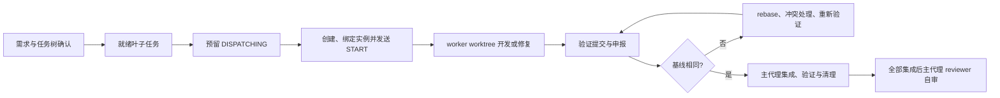

# Agent Worker

对外 Agent 名称为 `agent-worker`，资源位于 `agents/agent-worker/`；实现子代理仍名为 `task-worker`。历史运行状态目录 `task-orchestrator/<run_id>/` 与 `refs/heads/task-orchestrator/` 临时分支前缀保持兼容，避免重命名后已有运行无法恢复。脚本入口仍为 `scripts/orchestrator.mjs`。

把已确认需求拆成任务树，由主代理按依赖调度单任务 worker；worker 在独立分支/worktree 实现、验证和提交，基线变化则 rebase 后再次申报。主代理完成集成、清理与最终 reviewer 自审。脚本使用 Node.js 22+ 和 Git，不调用模型。

schema 2 增加结构化 brief、生产/消费接口检查、DISPATCHING 预留和独立实例生命周期。主代理先预留，再用宿主创建工具创建并绑定实例，最后发送 START。任务回报区分 DONE、DONE_WITH_CONCERNS、NEEDS_CONTEXT、BLOCKED；观察与回报携带状态版本，旧消息不能覆盖恢复后的新状态。

Codex 不能关闭线程时，可在执行静止、工具排空且真实日志证明成立后 `retire-agent` 撤销任务授权为 RETIRED，保留 completed/interrupted 原状态。它不等于线程被删除；后续发现旧实例活动就拒绝清理或接管。具体证据与限制见运行协议。

[真实宿主验收](../../docs/TK-20261105-agent-task-orchestration/codex-acceptance.md)：当前 Codex 桌面原生子代理四个临时场景均 DONE；独立 CLI 与 Claude 的范围限制另列，不以单元测试代替宿主验收。

换设备或接续验收，先读[开发交接](../../docs/TK-20261105-agent-task-orchestration/handoff.md)，其中区分历史结果、新设备检查和不可迁移的运行证据。

## 入口与使用

Claude 与 Codex 声明分别在 `claude/` 和 `codex/`。本包尚未接入仓库部署器，资源存在不代表宿主已发现。按宿主原生方式加载声明，并在提示中传入 `packageRoot` 的绝对路径与目标仓库路径；本次交付不自动安装或改用户配置。

Claude 可将 agent-worker 声明用于主会话；Codex 的自定义 Agent TOML 用于角色派发，主会话规则见 `codex/main-session.config.toml` 配置片段，不使用假定的 `--agent` 参数。模型和权限继承当前会话。所需公共技能须已在会话登记；没有合法调用工具时依据用户授权读取登记入口执行，登记或权限缺失回报阻塞。

可用提示词：

> 使用 Agent Worker，packageRoot 为此资源包绝对路径，目标仓库为项目绝对路径。按指定 requirement.md 拆任务树，确认后执行，默认最多 3 个 worker。

> 恢复 runId 对应的运行，先核对 Git 与子代理实际状态，保留已有修改。



## 公共与专用技能

- `skills/orchestrate-tasks`：主代理调度、集成及完成门禁。
- `skills/execute-task`：worker 单任务执行、技能路由和 rebase 交接。
- feature 路由公共 dev-requirement，bugfix 路由 dev-debug。复用已确认 brief，跳过子任务需求/方案/调查文档创建，保留适用的推演、根因调查、TDD、审查及验证。
- 代码变更需要的 README、AGENTS、接口说明仍维护。子任务在 worker 自审，整体由主代理 reviewer 自审，均如实披露缺少独立审查。

## 脚本与证据

脚本命令与完整 JSON 契约见 [运行协议](skills/orchestrate-tasks/references/protocol.md)。CLI 接收文件或 stdin 中的 JSON，输出 JSON；退出 0 成功、2 需要 rebase、1 阻塞或输入错误。

```text
node agents/agent-worker/scripts/orchestrator.mjs --help
node agents/agent-worker/scripts/orchestrator.mjs preflight <repo> <input.json>
node agents/agent-worker/scripts/orchestrator.mjs init <repo> <confirmed-tasks.json>
node --test agents/agent-worker/tests/*.test.mjs
```

preflight 的 input.json 可为 `{}`。初始化要求目标分支干净、已有提交及任务树确认；运行状态在 Git common directory 下持久化，worktree 默认在目标仓库同级独立目录，可指定已授权位置。只在集成验证通过且 worker 已停止后清理。应用锁可在同机进程已退出时由 resume 恢复，Git 原生锁和无法证明安全的现场保留并报告。外部文件编辑不能由引用锁禁止；脚本核对检测到变化时暂停，不强制覆盖。

新任务要求 goal、nonGoals、constraints、verification 和 interfaces 等 brief 字段；接口检查验证生产者、contract 与显式/传递依赖，不能仅凭文件不重叠判定业务独立。完整输入见运行协议。原 schema 1 先只读识别，主代理确认补齐 brief 后用 upgrade-run 备份升级；现存分支、worktree、原 attempt 保留，旧实例从 UNKNOWN 开始核对。

代理失联保留预留和容量，不自动认定已停止。清理和换人需要当前实例终止观察，workerStopped 布尔值不能单独授权。原实例 resume-task 保持 attempt；retry 换人生成新预留并禁止复用旧实例 ID。脚本校验身份、版本与记录顺序，实际创建/查询/停止仍由 Claude/Codex 宿主工具完成，观察真实性由主代理核实。

验证证据必须是本轮真实命令、输出、退出状态与对应 commit；脚本校验结构及 Git 事实，主代理负责判断测试有效性与编号覆盖。测试使用临时 Git 仓库；静态配置检查、脚本测试与 Claude/Codex 真实宿主验收分别报告。

清理会保留含 ignored 私有文件的 worktree，由 worker 或用户确认并处理可再生缓存后重试；Git 忽略规则不是删除授权。创建前中断且尚无分支/目录时，可确认旧 worker 已停止后用 retry 接管；创建到一半或归属不明仍需保护性人工恢复。
