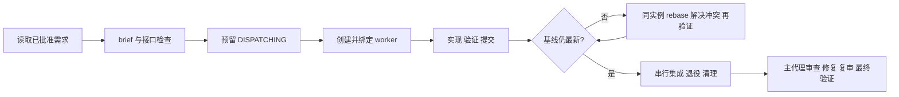

# Agent Worker 跨设备开发交接

更新：2026-11-07。此文件是接续开发入口；需求与方案已批准，不需要重新澄清。代码可以迁移，旧设备运行实例及原始验收日志不随 Git 迁移。

## 目标与事实来源

实现兼容 Claude/Codex 声明的 `agent-worker`：拆任务树、按依赖并行派发、每个 worker 独立 worktree 实现并提交、基线变化则反复 rebase/解决冲突/验证后申报，主代理串行集成、清理并完成 reviewer 审查闭环。

按顺序阅读：仓库 `AGENTS.md` → 本文 → [requirement.md](requirement.md) 的 B1–B37 → [proposal.md](proposal.md) 第 14、15 节 → [资源包 README](../../agents/agent-worker/README.md) → [运行协议](../../agents/agent-worker/skills/orchestrate-tasks/references/protocol.md) → [验收记录](codex-acceptance.md)。完整方案保留历史记录，最新实现与宿主结论以第 15 节及验收记录为准。

固定决策：公共技能使用仓库现有技能，其他技能仅属于此 Agent；feature 调用 dev-requirement，bugfix 调用 dev-debug，仅跳过子任务流程文档创建；主代理整体自审闭环；部署暂不处理。用户已授权持续定位、修复、复审、验证，不新增逐轮审批。本仓库不自动创建分支或提交；任务工作分支/worktree 由已批准的编排协议管理。



## 当前完成度

| 范围 | 状态及证据 |
| --- | --- |
| B1–B37 资源、协议及脚本 | 已实现；schema 2、brief/接口、预留、分类回报、生命周期、并行 worktree 与 Git CAS 集成 |
| Codex 桌面原生子代理 | 2026-11-06 四临时场景 DONE：并行、绑定边界创建返回丢失、rebase、停止后接管 |
| 自动回归 | 2026-11-07 交接前重跑完整 66/66，0 失败/跳过；新设备须重跑，不能继承通过结论 |
| 独立 Codex CLI | 曾验证原生角色加载及部分并行/rebase；修复后完整复测被自动审批超时阻塞，尚未全程通过 |
| Claude 真实宿主 | 未验收；旧设备当时未找到 CLI，新设备重新探测 |
| 部署 | 用户明确暂不处理，尚未集成部署器 |

当前不能宣称两平台全面验收完成。需求、设计、代码及已知缺口足以交接；剩余工作主要是宿主验收，发现问题继续按已有需求修复。

最新修复针对 Codex completed/interrupted 线程仍可恢复、无法证明永久关闭的问题。`scripts/lib/codex-retirement.mjs` 核验原始 JSONL 中直接控制器、同根 session、绑定时间窗、真实查询和工具排空，产生 `RETIRED` 授权退役；dispatch/lifecycle/runtime 在清理、释放、接管、集成、完成时复查证明。它不是线程删除，退休实例禁止恢复；原日志变化必须阻塞。回归位于 `tests/retirement.test.mjs`。旧 namespace `task-orchestrator` 为兼容保留，勿仅因改名清除。

## 新设备接续

1. 获取包含本文件的提交及此前历史；只有旧设备本地 commit 不等于已传到新设备。不要只复制忽略目录或聊天摘要。
2. 安装/确认 Node.js 22+ 和 Git，核对工作区及宿主版本、当前 `--help`。Agent 脚本使用内置模块；如维护脚本缺依赖，按根 README 使用 `npm install --ignore-scripts`，不自动运行联网升级或部署。
3. 从仓库根目录执行以下检查，记录本设备的真实输出。失败先定位，不把旧设备结果作为本次结果。

```powershell
git status --short
git log -5 --oneline
node --version
git --version
node --test agents/agent-worker/tests/*.test.mjs scripts/upgrade/init.test.mjs scripts/deploy/deploy.test.mjs
```

4. 优先补齐独立 Codex CLI 的四场景全流程，再做 Claude 真实宿主验收；均只在新临时仓库和隔离配置目录中操作。主会话规则和 worker 声明加载方式见包内 `codex/`、`claude/`。实际派发、查询、停止、回报使用宿主原生工具，不能以脚本模拟替代。
5. 记录重复派发、遗留授权/写入者、保留线程、worktree 和人工介入；停止后接管与旧 attempt 重放必须实际执行。创建返回丢失明确标注故障注入边界；不能夸大为真实网络丢包。

旧 CLI 为 0.166.0-alpha.6；曾遇到 `--ephemeral` 缺父 rollout、旧 `-s workspace-write` 在托管配置下无效、PowerShell 及自动审批受限。隔离配置的受限可写临时根与系统 cmd.exe 曾使部分路径前进，最终审批服务超时仍阻塞。这里只是历史线索，须依据新宿主实际能力重新判断；不要改真实用户配置或绕过审批。

`.agents/`、上游技能镜像、`.review/`、node_modules 等可能未进入 Git。仓库有 Skill 文件不代表新会话已登记。依据实际技能目录核对 dev-requirement/dev-debug/reviewer 及依赖；缺少必要入口就报告具体阻塞，不伪造技能调用。新设备安装或部署不在本次交接操作中自动执行。

## 证据与运行状态的迁移边界

[便携验收摘要](evidence/codex-desktop-summary.json) 保留旧设备独立审计计数与受测脚本 SHA-256；它是历史摘要，不替代退役所需的原始日志。验收表中的 commit 是临时夹具仓库提交，不属于本源码仓库历史。

旧设备临时验收根为 `agent-host-acceptance-pk0k4gi4`，原始用户会话日志未纳入仓库；不要提交凭据、认证文件或完整用户日志。四个正式桌面运行已 DONE；早期独立 CLI 失败现场另留诊断，不应假报已清理。Git common dir 的运行状态、原生线程 ID 与日志路径无法凭源码恢复。新设备从新 run 开始；缺少原日志时不能把旧实例标成 STOPPED、重新退役或强行接管。宿主全局未知孤儿数仍未知。

可直接交给新设备 AI 的提示词：

```text
读取 AGENTS.md 和 docs/TK-20261105-agent-task-orchestration/handoff.md，沿用已批准 B1–B37 和方案 B。先核对工作区与本设备能力，重跑自动回归，再优先补齐独立 Codex CLI 四场景真实宿主验收，随后 Claude。仅使用临时仓库和隔离配置，不部署、不改真实用户配置、不自动创建本仓库分支或提交。区分历史证据与本次结果；先定位再修复，持续审查和验证。遇到审批或缺依赖阻塞，记录具体证据，不能用桌面通过或脚本模拟替代。
```
