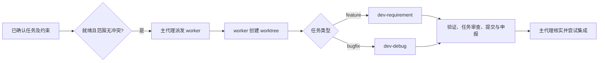
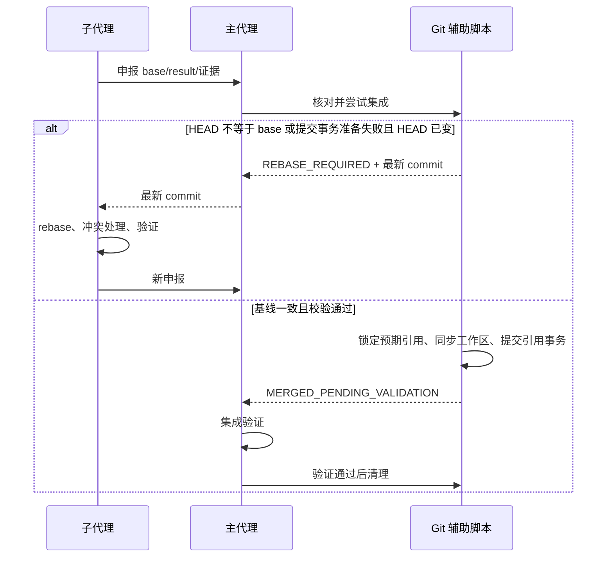
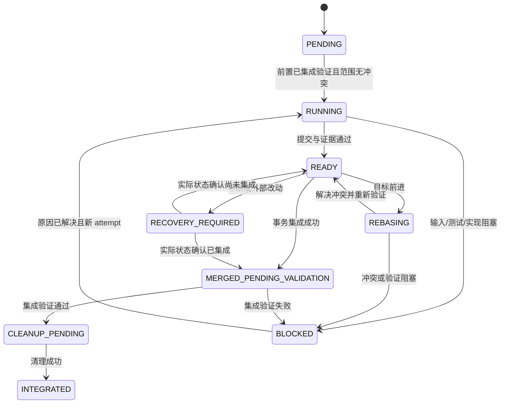
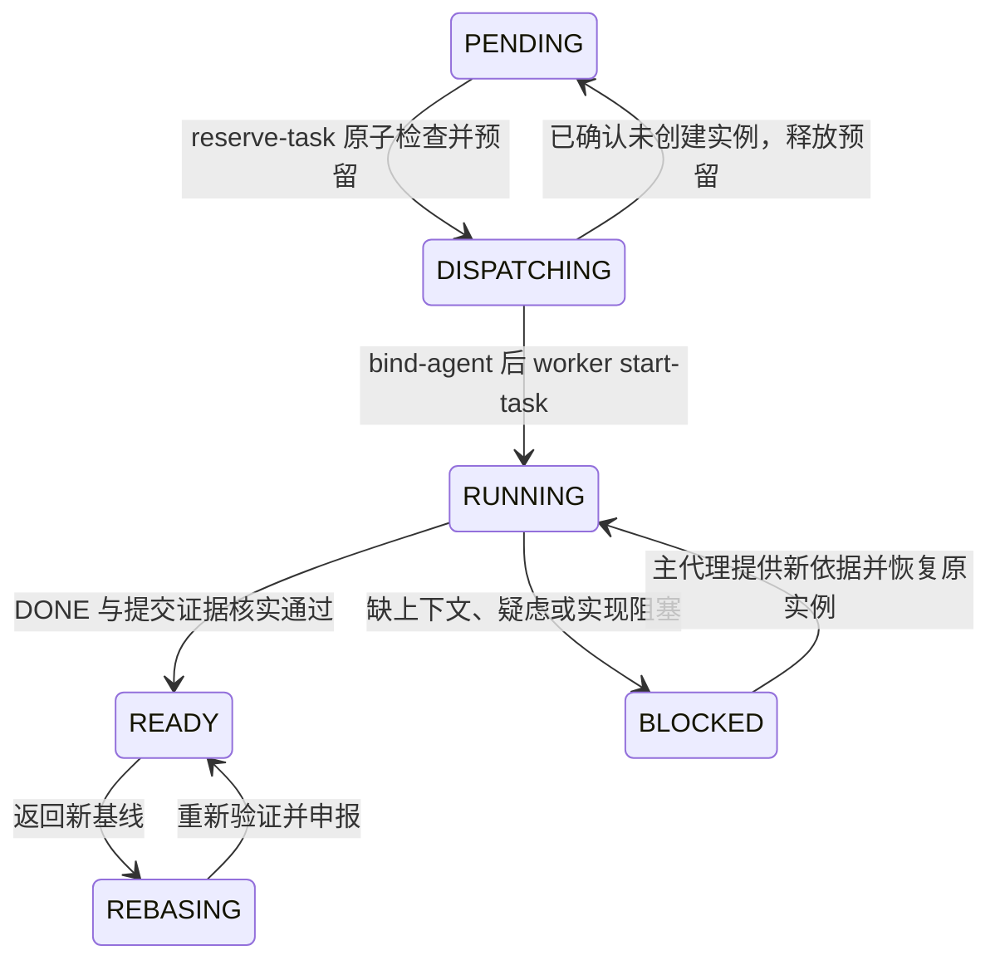

# TK-20261105-agent-task-orchestration 技术方案

状态：原方案 B 及 2026-11-06 第 14 节调度优化均已获批并实施；脚本验证与原生宿主验收的边界见末尾记录。

需求来源：[requirement.md](requirement.md) 的 B1–B31 及 Q1–Q16 确认记录。术语沿用根目录 [GLOSSARY.md](../../GLOSSARY.md)。本方案中的模块划分、状态存储、快进集成及子任务自审是作者提出的技术选择，随本文批准，不冒充此前已确认的需求。

## 1. 目标与边界

交付一个可分别用于 Claude Code、Codex 的任务调度 Agent：主代理把已确认需求拆成带依赖的任务树，用户确认一次后自动调度；实现子代理在独立 worktree 内完成单个叶子任务，提交并通过反复申报、rebase 和验证交回结果。主代理集成、清理，并亲自完成最终 reviewer 自审闭环。

本次不实现部署、安装、独立后台调度服务或平台之间的混合调用；不修改公共 Skill 默认行为，不复制公共技能为私有版本，不绕过宿主权限。资源放在 `agents/` 不等于已经被宿主发现。平台入口与运行说明属于交付，写入实际 harness 配置不属于本次交付。

## 2. 路线与取舍

| 路线 | 做法 | 取舍与决定 |
| --- | --- | --- |
| A：纯 Agent + Skill | 代理直接维护状态和执行 Git | 文件少，但竞态、重复申报和恢复规则主要依赖指令遵循；未选 |
| B：原生入口 + 专用 Skill + Node.js 辅助脚本 | 模型负责理解、调度、实现；脚本约束状态和 Git 操作 | 多一些代码，但核心协议可在临时 Git 仓库中验证；用户明确选择 |

沿用仓库 Node.js 22+、ES modules 和 `node:test`，运行部分优先使用 Node 内置库及 Git，不引入 Agent SDK、数据库或常驻进程。脚本不调用模型，不替主代理分配任务，也不自行解决代码冲突。

## 3. 资源结构与职责

```text
agents/agent-worker/
├── README.md
├── claude/
│   ├── agent-worker.md
│   └── task-worker.md
├── codex/
│   ├── agent-worker.toml
│   ├── task-worker.toml
│   └── main-session.config.toml
├── skills/
│   ├── orchestrate-tasks/
│   │   ├── SKILL.md
│   │   ├── README.md
│   │   └── references/
│   └── execute-task/
│       ├── SKILL.md
│       ├── README.md
│       └── references/
├── scripts/
│   ├── orchestrator.mjs
│   └── lib/
│       ├── state.mjs
│       ├── graph.mjs
│       ├── git.mjs
│       └── validation.mjs
└── tests/
```

- 平台声明只定义角色、工具适配与专用 Skill 的加载入口，不重复维护完整业务流程。
- `orchestrate-tasks` 负责需求入口、拆分、确认、调度、任务交接、集成及整体 reviewer 调用。
- `execute-task` 负责单任务 worktree、公共技能路由、流程文档覆盖规则、提交申报及 rebase 后的重新验证。
- 专用 Skill 的 references 保存输入输出契约、平台通信适配和异常处理，不复制 TDD、调试或审查的公共技能正文，也不绑定它们的内部步骤号。
- `orchestrator.mjs` 是统一命令入口，`state` 管持久化与互斥，`graph` 管依赖和文件冲突校验，`git` 管隔离、基线交接与集成，`validation` 管输入及证据结构校验。

实际文件拆分可根据实现复杂度微调，以上职责与边界不变。每个新 Skill 配中文 README；实现时同步根 README.md、README_CN.md 和受影响的 AGENTS 文档，不把将来能力写成现有能力。

## 4. 两平台入口与能力检查

Claude 入口采用 YAML frontmatter + Markdown 正文；可把调度角色作为主会话入口。Codex 自定义 Agent 使用包含 `name`、`description`、`developer_instructions` 的 TOML。两边分别调用各自实际提供的派发、通知、等待和恢复工具，共享任务消息结构。[Claude 官方文档](https://code.claude.com/docs/en/sub-agents)、[Codex 官方文档](https://learn.chatgpt.com/docs/agent-configuration/subagents)。

Codex 主会话与自定义子 Agent 声明分开：`main-session.config.toml` 提供主会话 `developer_instructions` 配置示例，加载调度规则；worker TOML 用于派发。不要把自定义 Agent 文件误当成通用 CLI 启动参数。本机 `codex --help` 没有 `--agent`；主会话使用已支持的配置入口或显式加载调度规则。[配置参考](https://learn.chatgpt.com/docs/config-file/config-reference)。本次只交付配置示例和说明，不安装这些配置。

启动检查宿主派发能力、可用并发容量、Git、Node、项目权限及所需公共技能登记入口。模型和权限沿用父会话，不在声明里硬编码另一模型或扩大权限。能力不足时报告阻塞，不静默退化成主代理代写全部实现。

公共 `dev-requirement`、`dev-debug`、`reviewer` 当前均设置 `disable-model-invocation: true`，不能简单列入 Claude 的 `skills:` 就宣称预加载成功。根据本次明确授权，从当前会话登记入口读取并执行所选公共技能及所需 references；具备适用调用工具时使用其合法调用方式。登记缺失或读取受限就报告阻塞，不关闭该标记、不猜仓库镜像替代路径。[Claude 技能加载限制](https://code.claude.com/docs/en/sub-agents#preload-skills-into-subagents)。

专用 Skill 使用已解析的包根目录绝对路径加载，公共 Skill 使用登记入口。派发包携带经校验的资源路径及版本摘要，切换 worktree 后不依赖原工作目录猜相对路径；资源发生变化时停止沿用旧确认。专用资源由显式入口读取，并不要求被安装成全局技能。

## 5. 运行数据与消息

每次执行生成独立 `run_id`，与需求的 task-id 分开；一个需求可以有多次运行。同一仓库、同一目标分支一次只允许一个活动集成者。初次运行要求普通已提交 Git 分支、干净工作区及暂存区；detached HEAD、未完成的 merge/rebase 或缺少初始提交时说明阻塞。

运行记录保存在 Git common directory 下的 `task-orchestrator/<run_id>/`，通过 Git 查询真实路径，不能假定 `.git` 一定是目录。记录不进入产品版本、不创建子任务需求文档。保存带版本号的状态快照、不可变事件、验证输出与事务日志；写操作先取得应用锁，采用临时文件写入、同步和替换，事件序号与状态版本用来识别不完整写入。记录损坏时保留原件并阻塞，不初始化空账本掩盖问题。

worktree 默认位于目标仓库同级的 `.<repo-name>-task-worktrees/<run_id>/<task_id>/`，可在运行输入中指定其他允许位置。启动时检查实际写权限与父会话允许范围；无权限时回报，不能自行改权限。路径和分支归属写入运行记录，禁止把任意调用方路径直接当清理目标。

| 对象 | 必需信息 |
| --- | --- |
| 运行 | schema/version、run_id、需求路径及摘要、确认记录、目标仓库/分支/worktree、起始 commit、平台、并发上限、状态 |
| 任务 | task_id、父节点、kind=feature/bugfix、B 编号及原文、验收条件、技术约束、允许文件范围、依赖、状态、派发代次 |
| 执行实例 | agent_id、worktree/临时分支、起始及当前 base_commit、result_commit、会话恢复信息、当前操作 |
| 验证 | 任务/阶段、完整命令或命令参数、cwd、对应 commit/内容摘要、退出状态、检查结果及日志路径 |
| 完成申报 | run_id、task_id、attempt_id、report_id、base_commit、result_commit、变更范围、验证证据、剩余问题 |
| rebase 请求 | task_id、attempt_id、申报版本、最新目标 commit、处理原因 |

主代理是任务图和整体状态的唯一决策者；子代理只提交自己当前代次的任务事件。重复 `report_id` 返回已有结果，旧 `attempt_id` 不再触发 Git 写操作。申报中的成功标记只是输入，脚本和主代理还要核对实际仓库及证据。

JSON 是内部协议，不是宿主或公共技能原有参数。接收时校验 schema、字段、状态转换和路径归属，未知枚举/缺字段拒绝；Git 调用使用参数数组，不拼接 shell 字符串。

## 6. 拆分、调度与子任务执行

主代理拆出任务树和独立依赖图：树表示归属，依赖图必须无环。父节点不派发；叶子任务有需求编号、文件范围与验收条件。feature 任务的最小技术做法或已批准方案引用纳入待确认的任务内容，不能只凭标题派发后假定方案已获批准。

用户一次确认任务树及其约束后，主代理将确认摘要记录到运行中。只派发前置任务已经集成且验证通过的叶子任务；默认最多 3 个实现实例，按调用参数和平台实际剩余容量取可用值。文件范围重叠则串行；目录范围保守覆盖其子路径。README、共享配置、生成文件和测试夹具同样计入范围，不能因业务模块不同就判为无冲突。



worker 在自己的绝对 worktree 路径执行所有变更命令。宿主若共享初始 cwd，则每次命令显式指定 cwd；不声称创建子代理天然隔离磁盘。创建完成前不编辑目标项目。宿主自带自动 worktree 生命周期不作为默认方案，避免它在任务回报后自行清理、破坏后续 rebase。

### 公共技能的调用覆盖

调用协议显式携带本轮授权的覆盖说明，公共 Skill 文件保持不变：

1. 需求、编号、约束、验收条件及相应批准记录由任务 brief 提供。feature 的已确认技术做法替代子任务 proposal 文件作为实施依据；已有根方案可只读引用。
2. 覆盖创建子任务需求/方案/术语/调查报告及要求这些新文件存在的门禁。保留需求核对、适用的技术推演、根因调查、TDD、审查、反馈处理和最终验证，具体算法仍由公共技能维护。
3. 运行记录承载过程证据，不让子代理编辑主需求或伪造 DR/DD 文档路径。缺少约束、方案或确认依据时回主代理，不以“跳过文档”跳过批准。
4. 子任务采用公共技能已有的“当前会话实现与自审”方式：当前会话指该 worker，不再递归创建实现者或审查者。明确报告子任务自审；整体审查仍由主代理按 B22–B25 执行。此执行方式已随本文获得批准。
5. README、AGENTS、接口说明等代码配套文档照常维护，计入允许范围和提交；流程文档豁免不影响这些义务。

子代理任务审查通过后只提交自己的改动。主代理在申报时核对提交真实存在、位于该任务分支、变更不越界、worktree 干净、无进行中的 Git 操作，以及证据对应申报版本；不把“已提交”等同于“已验证”。

## 7. 反复交接与安全集成

选用保留任务提交的快进集成：成功 rebase 后，目标分支是任务结果的祖先，可以直接前进到 `result_commit`；不 squash，不额外创建无内容的合并提交。rebase 可改写尚未集成的任务提交，已集成历史不改写。是否已有结果被集成以日志和提交关系核实，不能重复合并。



主代理只串行执行短时集成操作，不占用集成锁等待 worker rebase。其他任务可继续实现和回报。worker 收到新基线后，在自己的分支上 rebase 到精确 commit；失败保留现场，由 worker 解决冲突。成功后必须重新验证，旧结果失效。只在成功后更新 `base_commit`、`result_commit` 并申报；不在 rebase 进行中发布新基线。

### 检查与更新之间的竞态

仅先读取 HEAD、再执行普通 merge，不能保证 B13。本方案采用带预期旧值的 Git 引用事务：`update-ref` 的旧值校验及 prepare/commit 是 Git 提供的能力；下面的工作区事务协议是本项目设计，需要实现阶段的隔离测试验证。[Git update-ref](https://git-scm.com/docs/git-update-ref)。

1. 取得仓库级应用集成锁，重读目标分支、HEAD 指向、index、工作区和申报版本。分支或工作区出现用户改动则保留并阻塞；单纯目标 HEAD 前进且工作区一致则返回最新 commit。
2. 确认 `base_commit` 等于目标 HEAD，且 result 是 base 的后代；记录持久化集成意图，包含目标 ref、旧值、新值、旧/新 tree、原 index 摘要及申报身份。
3. 通过 `git update-ref --stdin` 准备事务：验证 HEAD 仍指向启动时的目标分支，并以 base 为预期旧值锁定目标 ref。使用 Git 提供的符号引用验证能力；当前 Git 不支持所需命令时阻塞，不降级成无保护合并。prepare 失败须区分目标变化、锁占用、权限及其他错误，只有确认目标变化才返回 rebase 请求。
4. prepare 成功并保持 Git 进程及引用锁后，再核对工作区/index。使用保护本地改动的双树工作区更新，把干净的 base 状态同步到 result；不用强制 reset。同步后核对 index 的 tree、跟踪文件及未跟踪文件状态，确认对应 result 且没有新增用户改动，记录工作区阶段，再 commit 引用事务；不满足就进入失败恢复。双树操作可据 Git `read-tree -m -u` 实现，需检查实际树和退出结果。[Git read-tree](https://git-scm.com/docs/git-read-tree)。
5. 确认目标 ref、index 和工作区均对应 result 后，记录 `MERGED_PENDING_VALIDATION`；此时才认为 Git 集成成功。不得因 Git 引用已更新就提前发完成事件或删除 worktree。
6. 任一中间步骤失败：先结束/中止自己的引用事务，再核对实际状态。只有能证明工作区/index 仍完整等于本次写入的新树、无新增用户修改且引用未提交时，才允许保护性逆向同步回旧树；否则保留现场进入 `RECOVERY_REQUIRED`。不自动回退已经提交的目标分支，不擅删未知 Git 锁。

引用事务防止正常 Git 写入在准备与提交间改变目标引用；它不构成跨文件系统与引用的原子事务，也不能禁止用户手工编辑文件。因此必须记录阶段、检验 index/工作区，并把不能无损判定的外部干预转为恢复阻塞，不能承诺任意进程并发写文件仍自动修复。

集成验证未通过时保留分支和 worktree，记录相关证据，由 worker 处理修复；已集成结果不反向 reset。此时暂停新的集成，其他无关任务仍可实现和申报，避免在未验证的集成状态上继续累积变更。修复复用原任务身份并增加 attempt，基线取当前目标状态；通过后再解锁依赖。

清理需要集成验证成功、结果已进入目标历史、任务分支仍是预期结果、worktree 干净且无活动 worker/操作。通过 Git 删除注册的 worktree，再删除该任务临时分支；禁止 force、目录递归兜底和删除未知资源。清理失败记为 `CLEANUP_PENDING`，保留记录并可幂等重试，不能标为整体完成。

## 8. 状态、异常与恢复



状态机不是仅凭事件推进；恢复时先核对资源、ref、Git 进行中操作和版本证据，再决定转移。`INTEGRATED` 同时满足集成、验证及清理；父节点根据叶子结果聚合。整体运行另有等待确认、执行、整体审查、阻塞和完成状态。

| 场景 | 恢复/停止规则 |
| --- | --- |
| 主会话中断、子代理仍在运行 | 核对持久化 agent_id 和平台实例状态，继续收集结果，不重复派发同一 attempt |
| 子代理实例不可恢复 | 确认旧实例已停止，核对 worktree 后以新 attempt 接管同一任务；不丢弃未提交修改 |
| 重复或过期回报 | 依据 report_id/attempt_id 返回既有结果或拒绝，不再次执行 Git 写操作 |
| rebase 中断 | 检查 rebase 状态，由该任务 worker 继续或报告，不把中间 HEAD 当完成结果 |
| worktree 已创建而状态未完成写入 | 按 Git 注册信息、预写事件和归属核对，能证明所属才接管；不明资源不删除 |
| 工作区同步或引用提交中断 | 对照事务阶段、实际 ref/index/tree 判定；可证明时恢复，混杂用户改动或未知锁时保留现场并报告 |
| 验证已过但相关内容变化 | 旧证据失效，重新运行受影响检查；只复用本轮仍对应当前状态的证据 |
| 任务失败无新证据、修复无进展 | 暂停该任务及后续依赖，继续无关任务；bug 修复失败计数随任务持久化，不因更换代理归零 |
| 运行记录缺失、资源丢失或 schema 不支持 | 不靠猜测重新创建/清理，报告恢复阻塞 |

失效应用锁只在可确认归属进程已退出且没有活动事务时回收；跨主机或状态不明不以超时为充分依据。运行记录和失败日志保留，成功清理只移除任务临时分支/worktree。

## 9. 整体审查与完成

所有叶子任务完成集成后，停止实现派发，由主代理调用已登记的公共 `reviewer`，携带需求、起始基线、集成结果、版本清单和验证证据，并显式要求已确认的主代理自审模式。反馈核实、代码修改、复审和最终验证均留在主代理；不派发新的审查或修复子任务。

主代理每轮修复验证通过后创建独立 commit，记录实际修改和新证据。若一轮修复跨多个已有编号，提交说明列出相应编号；不重写已集成历史。审查报告包含本轮任务提交和审查修复；若运行期间有外部提交进入目标分支，单独标记它们的来源和集成影响，不把它们冒称为本轮实现。权限、范围变化或用户新增编辑不能靠自审流程自动覆盖。

完成条件是：需求编号有验收证据、任务无待处理阻塞、集成资源清理完成、整体审查问题已处置且最终验证支持结论。自审标注缺少独立审查，零测试/环境阻塞/未执行不等于通过。交付包含提交清单、实际命令和结果、恢复/失败记录及剩余限制。

## 10. 脚本接口与验证计划

统一入口提供 `preflight`、`init`、`plan`、`start-task`、`report`、`rebase-target`、`integrate`、`record-validation`、`cleanup`、`resume`、`status`。以结构化 JSON 输入输出和明确退出状态交接：成功、需 rebase、任务阻塞、需恢复、非法输入。最终子命令名由实现者保持一致即可；状态含义与不越权边界不可省略。脚本只校验证据结构和 Git 事实，不自动证明测试内容正确，主代理仍核对原始输出与验收覆盖。

下表是实施后应执行的验证，当前尚未执行。所有 Git 写操作测试使用临时仓库，绝不在本仓库创建测试提交或真实用户 harness 中安装配置。

| 验证层 | 必测场景 |
| --- | --- |
| 状态与调度单元测试 | 有环/缺依赖/非叶派发拒绝，文件及目录重叠，默认并发 3，重复回报、过期 attempt，schema 校验，写入中断 |
| Git 集成测试 | 独立 worktree 实现提交，双任务反复 rebase，目标在检查与 prepare 间前进，目标引用锁，工作区/index 外部变化，验证失败保留资源 |
| 事务恢复测试 | 在意图记录、prepare、工作区同步、引用 commit、状态持久化和清理各阶段注入退出；验证无静默丢改、误报完成、重复合并或误删 |
| 清理测试 | 分支已变化、worktree 有修改/锁/活动实例、重复清理、路径逃逸、符号链接或 junction，Windows 路径含空格 |
| 技能契约检查 | feature/bugfix 正确路由，未创建子任务流程文档，保留 TDD/根因证据与代码文档维护，公共依赖缺失阻塞 |
| 两平台声明静态检查 | YAML/TOML 字段和入口引用、专用资源完整性、无错误的预加载声明、无权限或模型硬编码、README 一致 |
| 宿主真实验收 | Claude 与 Codex 分别执行 feature、bugfix、并行后 rebase、冲突、恢复、最终主代理自审；记录宿主版本与实际证据 |

本机已找到 Git、Node、Codex 可执行入口，未在 PATH 找到 Claude CLI；这仅是当前环境观察，不代表 Claude 运行能力已验证。宿主真实验收缺环境时如实报告未执行；不能用静态解析或脚本测试替代两平台实际运行。

## 11. 需求覆盖

| 需求编号 | 对应方案 |
| --- | --- |
| B1、B2 | 第 3–4 节：agents 资源包、双平台原生入口、公用与专用技能分离 |
| B3 | 第 1、6 节：已确认需求入口，缺口返回公共需求澄清 |
| B4、B5、B6 | 第 5–6 节：任务树、依赖图、一次确认、叶子与并发约束 |
| B7、B8、B9 | 第 3、6 节：主子职责、worker worktree、验证提交与申报 |
| B10、B11、B12 | 第 5、7 节：固定目标、base/result 与反复 rebase 协议 |
| B13、B14 | 第 7 节：预期旧值引用事务、串行短时集成与反复交接 |
| B15、B16 | 第 7–8 节：集成验证后清理、冲突与失败保留 |
| B17、B18、B19 | 第 6–8 节：依赖暂停、无关继续、失败有界与主代理协调 |
| B20、B21 | 第 5、8 节：持久化、实际 Git 恢复核对和启动干净状态 |
| B22、B23、B24、B25 | 第 9 节：主代理 reviewer 自审、修复提交、最终证据 |
| B26、B27 | 第 6 节：feature/bugfix 公共技能路由 |
| B28、B29、B30、B31 | 第 6 节：流程文档创建豁免、适用步骤与代码文档保留、缺口回报 |

## 12. 批准与实施边界

- 已确认：需求 B1–B31；用户选择方案 B。
- 已批准：本文具体技术设计，包括双平台主会话适配、任务记录、子任务自审、引用事务与恢复机制。
- 实施阶段可决定：内部函数名、JSON 文件拆分、日志压缩、测试夹具组织；不得改变职责、审批边界、清理条件和失败语义。
- 本轮只写方案及相关确认状态，不创建 Agent 文件、脚本、分支、commit，不执行安装或部署。批准后按调用方要求交付或进入后续工作，不自动调用 writing-plans。
- 独立读者检查：2026-11-05 已由独立新上下文代理阅读本文及需求文档，结论为“nothing important left”；不替代用户批准、代码审查或运行验证。
- 批准记录：2026-11-05，用户在收到本文链接及技术选择摘要后回复“批准”。本次仅同步批准状态与记录，未改变技术设计；后续影响需求或技术路线的变更需重新确认受影响部分。

## 13. 实施记录

- 2026-11-06 按用户要求，资源包与主 Agent 更名为 `agent-worker`；实现子代理 `task-worker`、脚本名及历史状态/分支 namespace 保持兼容。本文目录和入口引用按新名称更新，任务调度逻辑未在本次重命名中改写。

- 用户随后调用 dev-requirement，明确复用本目录文档实现，并选择主代理实现、独立子代理审查。沿用原 TK ID 与已批准编号，不重建 DR 文档，不创建本仓库分支或提交，保留已有暂存版本。
- 资源、专用技能、统一 CLI、状态与 Git 脚本落在 `agents/agent-worker/`；命令及实际 JSON 契约以包内运行协议为准。`init` 同时接收已确认任务图，`status` 返回可派发任务；另外提供阻塞、接管与最终完成命令。
- 实测校正第 7 节的 Git 细节：Git 2.49 拒绝在一个事务中同时 `symref-verify HEAD` 和更新其目标分支，报 multiple updates。实现使用目标 ref 的预期旧值 prepare/commit 事务，并在工作区同步前、提交前后及逆同步前核对 HEAD 分支；目标分支前进仍受 CAS 保护。外部 checkout/文件编辑不能靠引用事务完全隔离，检测到变化时保留现场进入恢复，不能表述为跨文件系统原子更新。
- 独立审查发现的 BLOCKED 容量耗尽、ignored 文件覆盖/清理风险、创建意图中断接管及逆同步分支保护已修复，并添加相应红绿回归；审查代理复核关闭发现。脚本测试与静态检查结果另在本轮交付报告列出，不将其当成两平台宿主真实验收。
- Claude/Codex 的真实宿主 feature、bugfix、通信与恢复闭环未执行。工作区同步中间状态不能无损判定时保持 RECOVERY_REQUIRED，可能需要人工保护性恢复；尚未验证全部事务崩溃注入窗口，不宣称任意中断均可自动恢复。

## 14. 调度优化扩展（2026-11-06，已批准）

### 14.1 路线与边界

对应 B32–B37。沿用现有“原生宿主负责子代理工具，Node 脚本负责协议与持久化”的路线，补全交接状态。不引入 SDK/常驻服务，不把 Superpowers 的串行 SDD 整套替换当前并行流程；这两种替代路线分别会改变原技术边界或丢失已确认并行能力。

用户已选择前轮建议并于本轮回复“批准”确认下列设计。公共技能路由、worktree 创建者、rebase、目标分支 CAS 集成、ignored 文件保护、最终主代理自审均保持原职责。

### 14.2 任务 brief 与接口检查

- 为叶子增加结构化 brief：目标、非目标、B 编号原文、验收、文件范围、技术做法、约束、验证命令，以及 `interfaces.provides` / `interfaces.consumes`。接口项有稳定 name 和 contract；消费项另有 from（生产任务 ID）。公共全局约束和来源版本一并交接。
- 派发前校验 from 存在且为叶子、生产方声明相同 name/contract、消费方显式依赖生产方（可经传递依赖）。有契约矛盾或缺依赖就拒绝派发，不猜测自动加边。共享文件的任务继续串行；任务正文要求双方协作但没有声明的接口，主代理仍需在计划核对中补齐。
- 提供只读 `task-brief` 与 `check-plan`：返回确定的任务内容、来源摘要、全局约束、已集成依赖提交及接口检查结果。brief 按确认版本计算摘要，dispatch 和回报引用该摘要；不会把整个主会话历史传给 worker。
- 结构化检查只能证明声明一致，不能证明接口实现语义正确；实际代码、测试和最终集成审查仍须验证。

### 14.3 创建前预留与启动交接



1. 主代理先调用 `reserve-task`，在应用锁内检查前置已集成、文件与接口约束、容量；写入 DISPATCHING、递增 attempt、随机 reservationId、brief 摘要和预留时间，然后才调用宿主创建工具。
2. 创建成功后用 `bind-agent` 将返回的 agentId 绑定到同一个 reservationId/attempt。重复同一绑定幂等；其他实例不能占用已绑定任务。
3. 初始派发只携带 reservationId、attempt 和 brief 摘要，不要求 worker 自行知道宿主实例 ID。主代理取得创建结果、完成绑定后，向同一实例发送 START 消息，明确交付 agentId；worker 再带齐上述身份调用 `start-task`，校验成功后才创建原有 worktree。早到的无 agentId 请求只校验预留并返回 WAITING_FOR_BINDING，不写 Git；主代理绑定后恢复原实例，不新建第二个实现者。
4. 创建工具明确证明没有实例产生时，`dispatch-failed` 可释放预留回 PENDING，下次预留使用新 attempt/id。创建请求超时、返回丢失或实例身份不明时保持 DISPATCHING 与 UNKNOWN，不自动释放容量；先通过宿主查询/人工确认消歧。若后来识别出实例曾被创建但已终止，允许主代理先补绑该实例、记录宿主终止观察，再关闭旧预留回 PENDING；缺少实例归属或终止证据就继续 UNKNOWN。迟到的旧绑定不能复活已经关闭的预留。
5. 重复 reserve、迟到 bind、旧实例 start/report 都受 reservationId/attempt/brief 摘要校验。绑定后不能用“创建失败”绕过停止证据释放任务。

### 14.4 子代理生命周期与容量

- 为每个 attempt 保存独立实例记录和历史，状态为 CREATED、ACTIVE、WAITING、STOP_REQUESTED、STOPPED、FAILED、UNKNOWN，记录身份、观察时间、来源及观察 ID。任务状态继续表示实现与 Git 进度，两者不混用。
- `agent-observation` 接收主代理从真实宿主工具得到的观察，按实例和 attempt 校验，重复观察幂等、过期观察拒绝。已终止实例不能被迟到心跳重新激活；新实例必须经新 attempt 接管。
- worker 自报进度/心跳可更新活动时间，但不能作为已停止或已终止证明。超时只转 UNKNOWN；失联不等于失败，不据此自动重派或清理。
- DONE 后实例通常为 WAITING，仍可恢复来处理 rebase。需要清理/接管时，主代理先请求停止并取得对应实例已停止的宿主观察。原 `workerStopped:true` 不能单独放行清理或换人。
- 容量计算包含 DISPATCHING 预留以及非终止实例，UNKNOWN 和 STOP_REQUESTED 继续占用；无实例运行的 BLOCKED 任务保留文件范围但释放执行容量。实际宿主剩余容量依然是上限。
- Node 脚本不直接连接 Claude/Codex 控制面：创建、查询、停止、恢复使用宿主实际工具，主代理传递观察证据；工具不可用或不能确认停止时保留 UNKNOWN 并阻塞相关操作。这里是受校验的生命周期协议，不冒称脚本能独立探测远程进程。

### 14.5 分类回报与主代理处置

| 回报 | 必需信息 | 处置 |
| --- | --- | --- |
| DONE | 当前 attempt/预留/brief 摘要、提交与通过的验证证据 | 沿用已有 Git 事实核对，允许 READY；实例转 WAITING |
| DONE_WITH_CONCERNS | 完成证据、分类疑虑（正确性/范围/信息性） | 保留结果，默认阻塞集成；信息性疑虑由主代理记录已核实后可放行，正确性/范围疑虑须处理后重新申报 |
| NEEDS_CONTEXT | 缺失信息与影响范围 | 不要求伪造成功 commit/证据；保存上下文请求，主代理补充后恢复同一实例 |
| BLOCKED | 原因、已尝试措施和已有证据 | 暂停依赖；主代理补上下文、调整任务或升级执行能力，不能无变化重试 |

分类回报与 Git 的 READY/INTEGRATED 状态分开存储；reportId 和实例身份共同防重。`resolve-report` 记录主代理处置及新依据，不能直接把正确性缺陷标成成功。重用原实例继续修复时保持身份和失败历史；换实例须先确认旧实例终止，再以新 attempt 与新预留接管原 worktree，保留既有修改。任务拆分或范围变更仍回需求确认，不由 BLOCKED 自动授予权限。

### 14.6 兼容、模块与验证

- 状态升级为 schema 2，继续使用历史 task-orchestrator namespace。schema 1 初次只读识别；主代理补齐/确认 brief 后显式调用 `upgrade-run`，原状态完整备份，再原子保存新版。不得借升级改变原任务 ID、已确认行为、文件范围或依赖。旧 Git 提交、分支、worktree、事务信息和报告历史保留，不清理现场。
- 迁移时：PENDING 任务保持待预留；尚未结束的旧 attempt 生成一次持久化 reservationId 与已确认 brief 摘要，保留原 attempt 和原 agentId，生命周期先置 UNKNOWN。经宿主核对并向原实例发送带新预留身份的接续消息后，原实例可使用同一 attempt 继续；旧报告只作历史，不当作新版回报重放。已集成任务保留完成结果和历史身份，不伪造其停止观察。
- 原实例补上下文、修复或 rebase 使用 `resume-task`，身份与 attempt 不变；`retry` 明确变为换实例接管，必须有旧实例终止证据，新建 attempt/reservationId 并绑定新实例后接管原 worktree。旧版仅凭 workerStopped 布尔值并沿用 agentId 的重试入口取消，返回迁移/身份缺失提示。
- `start-task` 不再承担“隐式首次预留”；旧客户端收到明确的预留/绑定缺失错误。同步 CLI、两平台声明、专用技能、运行协议和 README；公共 Skill 文件不变。
- 将 brief/接口校验及 dispatch/lifecycle 分成内聚模块，runtime 只编排调用；现有 Git 集成实现保持，必要接入点仅增加实例身份与清理门禁。
- TDD 覆盖：接口不匹配/缺依赖、brief 版本变更、同时预留同任务、预留占容量与文件范围、创建明确失败与结果不明、早到 start、重复绑定、迟到旧实例回报、四类回报、停止观察门禁、失联不重派、原实例恢复与新实例接管、schema 1 保守升级，以及原并行/rebase/ignored 保护回归。
- 脚本与模拟宿主交接测试不替代两平台真实宿主验收。沿用已选的主代理实现、独立子代理审查；最终报告分别列出实际运行、未执行和环境阻塞，不自动提交或部署。

独立读者检查：2026-11-06 已执行，提出早到实例身份、UNKNOWN 退出及 schema 1 接续三个问题；均已在 14.3、14.6 明确处理，复核结论为“nothing important left”。批准记录：用户在收到第 14 节链接后回复“批准”，随后进入实现。

实现补充：实例保留生命周期 revision 和执行 executionVersion 两个版本。宿主观察携查询前的 revision，worker 回报携最近 start/resume 的 executionVersion，避免普通轮询使正常回报失效；旧宿主回调与旧执行回报分别拒绝。schema 1 历史实例 ID 同样禁止跨任务重用。绑定后启动前可以分类请求上下文，补齐后以同一实例继续启动。实际命令与字段以包内运行协议为准。

### 14.7 实施验证记录

- 已实现 B32–B37：brief/接口校验、预留及绑定、分类回报、实例观察/执行版本、停止门禁与 schema 1 备份升级。核心 `lib/git.mjs` 相对已提交版本未变，原并行 worktree、rebase 和集成回归保留。
- 最终实际执行 `node --test agents/agent-worker/tests/*.test.mjs`：35/35 通过；同轮维护脚本回归 `scripts/upgrade/init.test.mjs` 与 `scripts/deploy/deploy.test.mjs`：25/25 通过。另执行 JavaScript 语法、TOML 解析、Markdown 链接/代码围栏、Skill README 和 `git diff --check`，均通过；未测量覆盖率。
- 独立审查 LR-1～LR-4 已逐项复现、修复并复核关闭：启动预留误释放、终止状态回退、普通轮询使回报版本失效、迁移历史实例 ID 漏查。相关修复均有红绿回归。
- 仅以模拟宿主观察验证协议；未部署，未执行 Claude/Codex 原生宿主的创建、查询、停止、恢复端到端验收，不把协议/脚本通过视为宿主已验收。未创建本仓库分支或提交，既有重命名与用户改动保留。
