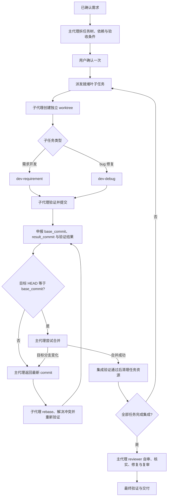

# TK-20261105-agent-task-orchestration

## 用户原话

> 实现一个兼容 claude & codex 的 agent 可以实现：分解需求为任务树 -> 主代理为任务调度，创建子代理实现单一任务（开启 git worktree > 实现任务 > git commit > 回报状态）-> 合并完成任务回当前分支，并删除 worktree -> 任务整体完成，使用 reviewer 审查整体代码

## 已确认行为

### 资源与输入

- B1. Agent 资源存放在仓库根目录的 `agents/agent-worker/`，分别提供 Claude Code 和 Codex 的入口；声明格式与指令编写符合各自平台要求。
- B2. 当前仓库已有 Skill 作为可复用的公共 Skill；为该 Agent 新增的专用 Skill 放在该 Agent 目录内，随其维护。公共 `reviewer` 及其他已有依赖不复制为私有副本。
- B3. Agent 接收已确认的需求文档；需求不明确时转交 `grilling-requirement` 澄清，确认后才拆分执行任务。

### 任务拆分与调度

- B4. 主代理将需求拆成任务树，记录跨任务依赖和验收条件，仅向实现子代理派发叶子任务，每个子代理一次只负责一个任务。
- B5. 主代理展示任务树、依赖和验收条件，取得用户一次确认后，自动执行本轮任务所需的 worktree、临时分支、实现、验证、提交、集成和清理操作。
- B6. 只有前置依赖已完成集成、且修改范围互不冲突的就绪任务才能并行执行；默认最多运行 3 个实现子代理，调用时可调整，并受平台实际能力限制。
- B7. 实现阶段主代理负责拆分、调度、Git 集成和状态管理；实现及需要修改代码的冲突、集成失败交由子代理处理。整体审查阶段按 B22–B25 由主代理直接执行。
- B8. 每个叶子任务由子代理创建独立临时分支和 worktree，从已经包含前置任务的最新集成结果开始实现。
- B9. 子代理在任务范围内完成实现、执行相关验证，并在验证通过后创建任务 commit；完成后主动向主代理申报任务状态、基线 commit、结果 commit 和验证结果。

### rebase、合并与清理

- B10. 集成目标固定为本轮启动时的当前分支。`base_commit` 是子代理起始 commit，或最近一次成功 rebase 到的目标分支 commit；`result_commit` 是子代理当前完成实现及验证后的任务提交。
- B11. 主代理收到完成申报后，将集成目标分支当前 HEAD 与申报的 `base_commit` 比较；两者相同才尝试合并申报的 `result_commit`。
- B12. 两者不同时，主代理向该子代理返回目标分支最新 commit；子代理执行 rebase、处理代码冲突、重新验证，并在成功后更新 `base_commit`、`result_commit` 及验证结果，再次申报。
- B13. 比较 HEAD 与实际合并之间发生的目标分支变化不能被遗漏；发生变化时重新交接最新 commit，不能按过期的基线完成合并。
- B14. 以“申报 → 比较 → 合并或返回最新 commit → rebase、冲突处理与验证 → 再次申报”为最小循环，持续迭代直至合并成功；不为等待某个任务 rebase 而停止其他互不冲突任务的实现或申报。主代理的实际合并操作串行执行。
- B15. 合并成功后，主代理执行集成验证；通过后才删除对应 worktree 和临时分支，保留已集成任务的提交历史。
- B16. 无法解决的冲突或验证失败进入阻塞与修复流程，不能通过反复申报、rebase 或重试合并跳过失败。

### 失败与恢复

- B17. 失败任务及依赖它的后续任务暂停，已确认互不依赖的任务继续；保留失败任务的分支、worktree 和日志，主代理根据原因安排修复。
- B18. 对同一失败反复尝试却没有新证据或进展时停止该项并报告，不无限重试；单纯因目标分支前进而重新交接，按 B11–B14 处理。
- B19. 实现期间需要代码修改的冲突和集成失败由子代理处理；涉及需求取舍、需求变更或无法自行解决的阻塞时询问用户，不能自行扩大已确认需求。
- B20. 持久保存任务树、依赖、任务状态、分支、worktree、相关 commit 和验证结果；会话中断后可恢复，恢复前核对实际 Git 状态，不能只根据保存的完成标记继续操作。
- B21. 新一轮执行启动时，当前工作区存在未提交改动则暂停，让用户处理，不自动暂存、提交或混入本轮任务。已有轮次中断后的恢复按 B20 核对，不将其任务内状态误当成新一轮启动状态。

### 整体审查与交付

- B22. 全部实现任务完成集成后，主代理使用公共 `reviewer` 对本轮全部集成改动执行整体审查；保留本轮起始基线及当前版本信息，使审查范围可核对。
- B23. 整体审查、反馈核实、代码修复、复审和最终验证全部在主代理进行，不再派发审查或修复子任务；按用户已接受的自审替代执行，并明确标注为“主代理自审”。
- B24. 整体审查期间，每轮修复验证通过后，由主代理创建独立修复 commit，不改写已经集成的任务提交；这些修复纳入后续复审和最终交付。
- B25. 范围内问题关闭且最终验证支持结论后才能宣告整体完成；未解决问题、失败、环境阻塞和未执行检查明确报告，不能作为全部通过交付。

### 子任务技能路由与文档边界

- B26. 子代理执行需求开发子任务时，使用公共 `dev-requirement` 技能。
- B27. 子代理执行 bug 修复子任务时，使用公共 `dev-debug` 技能。
- B28. 两种调用均复用主代理传入的已确认需求、行为编号、任务约束和验收条件，不另建子任务的 `requirement.md`、`proposal.md`、术语表或调查报告；这是该 Agent 调用公共技能时的流程覆盖规则。
- B29. 跳过子任务流程文档创建不等于跳过必要的方案推演、根因调查、TDD、审查或验证；按任务类型保留适用步骤，过程与证据通过任务状态回报主代理。
- B30. README、AGENTS、接口文档等与代码变更直接相关的文档，仍按目标仓库要求新增或更新，不属于 B28 跳过的流程文档。
- B31. 子代理获得的输入不足或需要改变已确认行为时，回报主代理协调，不自行扩展范围或另建流程文档代替协调。

### 2026-11-06 调度优化补充

- B32. 为每个叶子任务提供独立、可交接的任务 brief，包含已确认目标、行为编号、验收、文件范围、技术约束和输入输出接口。
- B33. 派发前检查任务之间的接口依赖与约束冲突，不能仅用文件范围不重叠判定任务相互独立。
- B34. 创建子代理前先将任务原子预留为 DISPATCHING；创建失败、重复派发和启动交接均有可追踪状态。
- B35. 将子代理生命周期与任务执行状态分开管理，记录实例身份、启动、等待、停止与失联状态，并据此约束恢复与接管。
- B36. 子代理采用 DONE、DONE_WITH_CONCERNS、NEEDS_CONTEXT、BLOCKED 分类回报，由主代理按类别处置，不能把所有回报直接当作实现完成。
- B37. 本轮优化保留已有并行 worktree、rebase 交接与 Git 集成机制，继续复用原公共开发/修复技能和最终主代理审查流程。

## 流程

图示为成功路径；失败、阻塞及恢复分别按 B16–B21 执行。每轮整体审查修复按 B24 验证并提交。两种子任务技能路由均按 B28–B31 跳过流程文档创建、保留适用步骤与代码配套文档维护。

## 非目标

- 本次不处理部署流程或将资源安装到实际 Claude、Codex 环境；不扩展现有部署脚本。
- 不要求宿主强制禁止其他 Agent 调用专用 Skill；专用性指目录、维护与分发归属。

## 未决

无。

## 确认记录

- 2026-11-06 名称变更：用户要求 Agent 改为 `agent-worker`，B1 的资源目录及当前入口引用同步更名；原 task-id、功能行为及运行状态格式沿用。

- Q1–Q6：用户确认 `agents/` 资源目录、已有公共 Skill 与新增专用 Skill 的边界、两平台各自合规的入口、已确认需求输入、依赖驱动的叶子任务并行，以及任务树确认后自动执行。
- Q7–Q11：用户确认临时分支与 worktree 隔离、提交与集成清理、默认并发 3、失败隔离、持久化恢复和启动时未提交改动处理；补充合并前由子代理 rebase 和解决冲突，整体审查全过程由主代理执行。
- Q12：用户将串行交接排队建议改为反复申报与比较最新 commit 的迭代流程。
- Q13：用户确认主代理每轮整体审查修复验证通过后独立提交。
- Q14：用户明确“部署暂不处理”，覆盖此前关于扩展部署流程的建议。
- Q15：用户明确“使用推荐。确认 Q12”，确认比较目标分支 HEAD 与 `base_commit`，区分 `result_commit`，检查到合并之间的目标变化重新交接，冲突无法解决或验证失败沿用阻塞处理。
- Q16：用户补充需求开发调用 `dev-requirement`、bug 修复调用 `dev-debug`，均跳过文档创建；随后明确“使用推荐”，确认仅跳过子任务流程文档创建，复用主代理输入，保留适用的推演、调查、TDD、审查与验证以及代码配套文档维护，缺少输入或变更行为时回报主代理。
- 方案生成：用户对是否生成该 Agent 的 `proposal.md` 回复“是”；该选择授权进入方案阶段，不代表技术路线或方案内容已经批准。
- 技术路线：用户明确“使用方案B”，选定原生 Agent 声明、专用 Skill 与 Node.js 辅助脚本；完整方案仍需另行批准。
- 方案批准：2026-11-05，用户在收到 `proposal.md` 及其技术选择摘要后回复“批准”，确认当前方案内容；未改变 B1–B31。
- 以上记录来自本次会话 2026-11-05 的逐项确认；被后续回答替换的建议不作为已确认行为。

## 阶段记录

- 2026-11-06 用户明确要求按前轮建议优化，新增 B32–B37；随后回复“批准”，确认 proposal.md 第 14 节细化协议并进入实现。原 B1–B31 和重命名改动保留。
- 本轮优化已落地，最终 Agent 回归 35/35、同轮维护脚本回归 25/25 通过，独立审查发现已修复并复核；原生宿主端到端验收未执行，详见 proposal.md 第 14.7 节。

- 需求阶段：B1–B31 已确认，书面检查完成；Q16 仅新增 B26–B31，B1–B25 保持不变，未决项为无。
- 技术方案：`proposal-mode=ask` 已选择生成，路线 B 已确认；同目录 `proposal.md` 已创建并完成独立读者检查，当前内容已获用户批准，需求与方案阶段完成，未进入实现。
- 后续实施：用户显式调用 dev-requirement 复用本目录实现，并选择方式 1（主代理实现、独立子代理审查）。Agent 资源与脚本已落地；B1–B31 不变，实际验证与环境限制见本轮交付及 proposal.md 实施记录，两平台宿主真实运行仍未验证。
