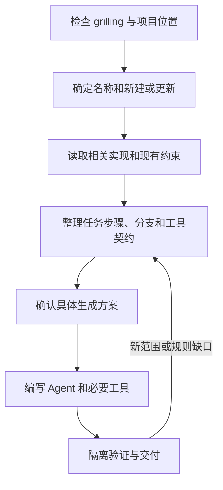
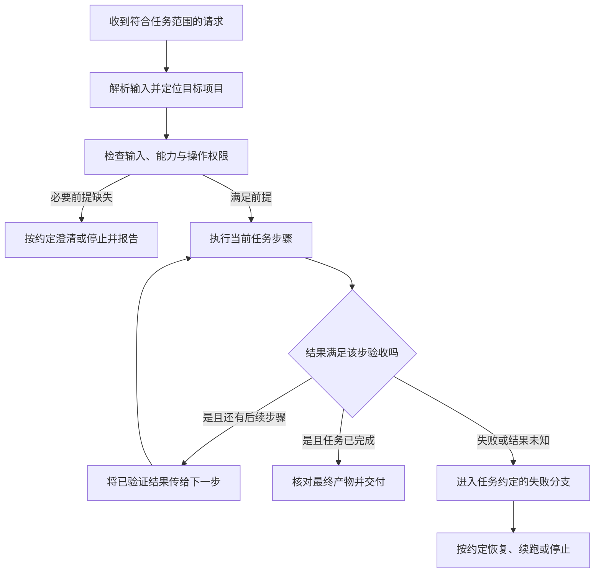
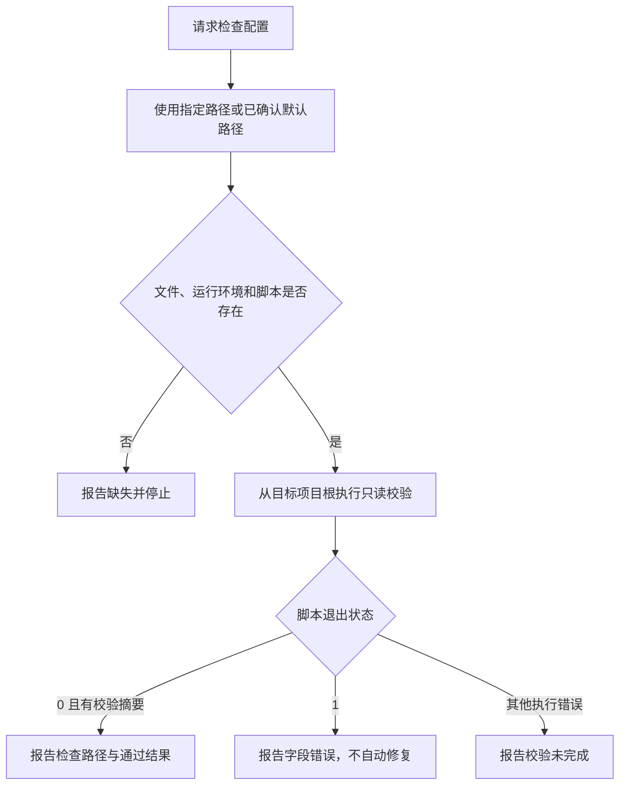

# agent-creator：生成项目任务 Agent

把一项明确的工作整理成可执行的项目技能，支持新建、重写和增量更新。重点是任务如何完成：输入从哪里来、每步做什么、结果如何传给下一步、失败时怎么办，而不只是写一个专家角色提示词。

## 如何触发

入口设置了 `disable-model-invocation: true`，应显式调用；具体调用语法取决于宿主。例如：

> 使用 agent-creator，为当前项目创建 config-check Agent：只检查配置，不修改配置。

> 使用 agent-creator，更新已有发布说明 Agent，保留默认输出，增加 JSON 选项。

“创建 Agent”“更新任务 Agent”说明适用意图，不代表宿主一定会自动路由。

## 内部流程

1. 从会话登记入口加载已安装的 `grilling`。确定目标项目和名称；名称统一为 `agent-<name>`，后缀用小写字母、数字和单连字符，完整名称最多 64 字符。需要转换名称时先确认。
2. 检查项目约定、当前改动和任务相关代码。更新已有 Agent 时，同时读取它的引用、工具脚本及其他调用者。
3. 提取输入、动作、判断条件、输出、验收、失败出口和权限；核对后续步骤的输入确实来自前一步或已知来源。优先复用项目现有能力。
4. 展示确切文件改动、依赖、删除项和验证案例，确认后写入；已经接受的相同方案不重复确认。
5. 在隔离环境检查正常、无效输入、中间失败、依赖缺失、重复执行和增量更新等适用场景。

## 生成的 agent-<name> 如何执行任务

上面的流程描述 **agent-creator 如何生成技能**。生成后的 `agent-<name>` 执行的是已确认的业务任务，不会每次重新跑生成访谈，也不自动继承生成器对 `grilling` 的依赖。

每个 Agent 的具体步骤由任务契约决定；下面是组织运行流程时需要表达的关系，不是强制所有 Agent 都照搬的固定模板：

| 运行环节 | 生成的技能需要写清什么 |
| --- | --- |
| 请求入口 | 哪些用户请求会触发、负责什么任务、哪些工作不处理 |
| 输入准备 | 必填输入、来源、合法形式、已确认默认值和项目根目录解析方式 |
| 能力检查 | 实际命令、工具或已安装技能，工作目录、参数、运行条件及必需/可选依赖 |
| 步骤执行 | 当前输入、判断条件、具体动作、可观察结果，以及下一步如何消费结果 |
| 条件路由 | 哪个结果进入哪条分支；何时读取 reference、调用工具或加载依赖技能 |
| 权限节点 | 哪些动作已有授权，哪些真实业务动作运行时仍需确认 |
| 失败出口 | 哪些步骤停止、输出什么诊断、哪些回退被允许，是否需要恢复资源 |
| 重复执行 | 已有产物如何处理、可复用哪些结果、能从哪里续跑；仅在任务需要时定义 |
| 最终交付 | 产物位置、结果格式、验收证据及未完成或未验证部分 |

必需前提失败会阻断依赖它的后续步骤，不能编造一个结果继续传递。只有输入和副作用互不冲突时，独立步骤才可继续。可选能力缺失只采用已约定的回退；任务没有允许重试时，不自行添加重试。

有副作用的动作还要区分“确定失败”和“结果未知”：例如写入后超时，先检查约定的完成证据，再决定是否重试，避免重复写入。生成器自身的确认、调研和验证记录不应直接复制成 Agent 每次运行的步骤。

### 示例：生成后的 agent-config-check

假设用户已确认默认配置路径为 `config/app.json`，并且项目已实现只读脚本 `scripts/check-config.mjs --file <path>`，约定退出码 0 为校验通过、1 为配置不合法。生成的 Agent 可以这样运行：

这里的路径、脚本和退出码来自示例契约，不是本仓库已提供的工具，也不是每个生成 Agent 的统一要求。发布说明 Agent 则应按自己的契约收集版本差异、调用文档能力、核对草稿并交付；“只生成草稿”不会自动变成发布操作。

## 路由与停止条件

| 条件 | 后续行为 |
| --- | --- |
| 名称、规则或方案存在必要决策 | 交给已安装的 `grilling` 澄清 |
| 已有工具能完成任务 | 直接复用，不额外包一层脚本 |
| 确实缺少工具能力 | 按已确认方案在目标项目根 `scripts/` 实现 |
| 必需依赖缺失 | 停止受影响步骤，不自动安装或换成同名副本 |
| 验证发现范围内实现缺陷 | 修复并重跑；新范围或政策问题回到澄清 |

## 产物与边界

- 默认入口：`<目标项目>/.agents/skills/agent-<name>/SKILL.md`；按需增加 `references/`、`assets/`。
- 配套脚本放在目标项目根 `scripts/`，迁移 Agent 时需同时考虑这些文件和外部依赖。
- 交付包含实际路径、可用调用示例、配套依赖和验证限制。目录存在不证明宿主已自动发现，未确认命名调用时提供完整路径调用。
- 生成 Agent 不授权执行它描述的真实业务操作。验证不以真实发布、部署、提交或业务数据写入作演示。

## 文件导航

- [SKILL.md](SKILL.md)：入口、生成流程和边界。
- [generation-contract.md](references/generation-contract.md)：任务建模与能力绑定。
- [output-examples.md](references/output-examples.md)：任务契约如何写成 Agent，含增量更新示例。
- [verification.md](references/verification.md)：隔离案例、产物核对和证据分类。
