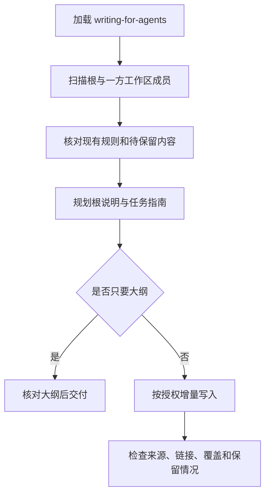

# agenter：维护仓库代理说明

根据当前仓库证据创建、更新、合并或拆分代理操作说明，让代理知道哪些约束每次都要遵守，哪些任务需要再读专项文档。每条规则都要有项目证据或已确认约定，不能凭通用模板补出不存在的流程。

## 如何触发

入口设置了 `disable-model-invocation: true`，应显式调用。例如：

> $agenter

> 使用 agenter，只更新 AGENTS.md 中的测试指令，保留其余约束。

> 使用 agenter，整理这个 monorepo 的代理说明，按任务拆分。

单独调用 `$agenter` 已表示授权扫描当前工作区，并创建或增量更新根 `AGENTS.md`，不再追问默认动作。仅在讨论中提及名字不算调用；“只给大纲，不落盘”覆盖默认写入行为。

## 内部流程

1. 从会话登记入口加载 `writing-for-agents`，在规划、写作、验证三个节点应用它。
2. 依据用户目标确定根目录；检查根和发现的一方成员的指令、清单、脚本、CI、README、现有指南及 Git 状态。记录每类来源是已读、缺失、不适用、不可读还是排除。
3. 每次任务都需要的规则放根 `AGENTS.md`；特定任务才需要的细节放适合的现有指南，或必要的 `docs/agents/<topic>.md`，根文件写清读取条件。
4. 根文件默认最多 200 行。局部更新遇到已有超长文件时保留无关内容，报告无法在范围内解决的超长问题，不借机全文重写。
5. 写前重读目标并处理后续编辑，只做最小语义更新。核对链接、命令来源、规则保留及代表性任务能否找到对应指南。

## 路由与权限

| 输入或条件 | 行为 |
| --- | --- |
| 裸调用 | 根说明及必要、带任务入口的 `docs/agents/` 指南 |
| 指定路径或局部更新 | 沿用更窄范围；读取其他文档不等于可以修改 |
| 只给大纲、评估、建议 | 只读交付，不写文件 |
| 全文替换某文档 | 需要针对该目标的明确授权，并核对将移除的约束 |
| writing-for-agents 缺失或不可读 | 可继续只读发现，规划和写入前停止 |
| 可选证据缺口 | 保留不确定规则，继续安全工作并披露 |
| 必要写入或检查失败 | 报告阻塞，区分已写、失败和未尝试目标 |

## 交付

最终采用三种状态之一：**完成 / 完成但存在缺口 / 阻塞**，附范围、变更或未变路径、实际检查和缺口。创建代理说明不授权执行其中的业务操作，也不自动创建嵌套 AGENTS、兼容链接、分支或提交。

## 文件导航

- [SKILL.md](SKILL.md)：调用契约与完整流程。
- [discovery.md](references/discovery.md)：扫描范围、来源和覆盖记录。
- [document-contract.md](references/document-contract.md)：信息层次、任务指针和交付状态。
- [existing-documents.md](references/existing-documents.md)：局部更新、替换和用户编辑保护。
- [acceptance-scenarios.md](references/acceptance-scenarios.md)：维护时使用的验收场景，不是自动运行器。
