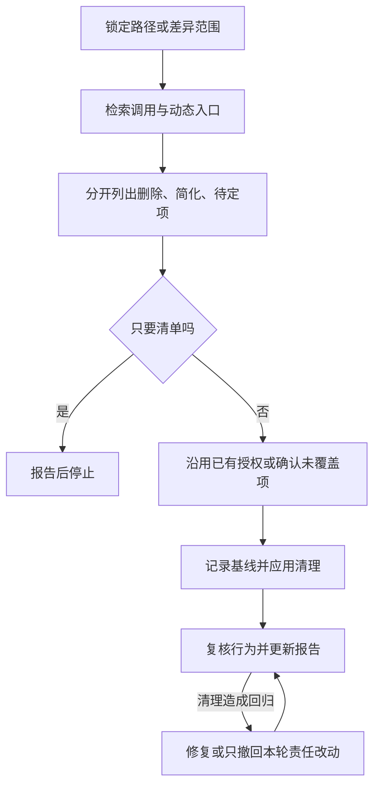

# clean-helper：有证据地清理代码

在明确范围内寻找死代码、废弃分支、无用导出和重复逻辑，先列证据，再按授权删除或简化。废弃标记、静态工具告警和“看起来没人用”都不能单独证明可以删除。

## 触发提示词

适用表达包括“清理代码”“删除废弃”“移除冗余”“无用代码”“废弃分支”“精简逻辑”，以及 `clean-helper`、`cleanup`、`dead code`、`remove deprecated`、`unused function`、`prune`、`unreachable code`。

> 清理 src/auth 下的死代码，先列清单，不修改代码。

> 使用 clean-helper，检查本次改动中的重复分支，应用已确认的安全删除项。

这些是意图示例；实际自动选择由宿主依据技能描述和上下文决定。

## 内部流程

1. 路径输入限定该文件或子树；空输入优先取暂存和未暂存差异，没有明确目标时再问。整仓清理会先确认，倾向逐模块处理。
2. 搜索静态引用、字符串动态调用、框架入口、配置、代码生成、反射和外部 API。有效的测试调用也算使用，不能连测试一起删来证明代码无用。
3. 分类记录无用导出、未引用函数、死分支、废弃 API、过期开关和重复块，并列证据及风险。删除与控制流简化分开说明。
4. 清理前记录文件、暂存区与相关验证基线。只应用已批准项；控制流变化和公开契约移除不能靠笼统“清理”授权推定。
5. 每个逻辑清理后验证。新增回归在范围内修复或局部撤回；既有失败、环境阻塞和归因不明分别记录。

## 路由与边界

| 条件 | 行为 |
| --- | --- |
| 只读清单 | 展示候选后结束，不改生产代码 |
| 用户已预先授权安全删除 | 复用授权，不重复确认同一项 |
| 动态入口或外部消费者证据不足 | 延后该项，继续独立安全项 |
| 需要改范围外调用者、测试或生成物 | 只读追踪；扩大修改范围前确认 |
| 恢复与用户后续编辑重叠 | 保留现场，说明具体冲突 |
| 退出码为 0，但零相关测试 | 标为未验证，不算行为保持通过 |

不强制调用其他技能；按阶段读取本目录 references。可选静态分析工具仅作交叉验证，不按工具输出直接删除。

## 产物与文件导航

默认 `.review/clean-{timestamp}.md` 保存候选清单、批准计划、实际删除或延后项和验证结果；指定目的地或严格禁写要求优先。默认不建分支、不提交。

- [SKILL.md](SKILL.md)：范围、确认、清理与恢复流程。
- [scope-and-targets.md](references/scope-and-targets.md)：路径、差异和暂存保护。
- [dead-code-discovery.md](references/dead-code-discovery.md)：死代码证据和误报检查。
- [redundancy-patterns.md](references/redundancy-patterns.md)：重复逻辑、分支和开关的简化判断。
- [verification.md](references/verification.md)：基线、失败分类和局部恢复。
