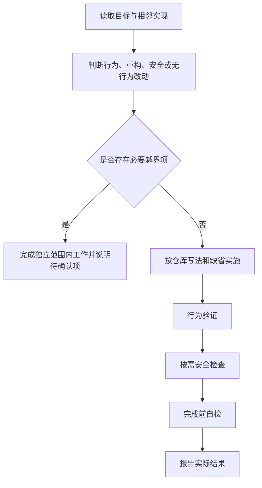

# coding-common：按仓库约定实现代码

实现功能、修复缺陷、重构或补测试时，先对齐目标文件和相邻代码，再用本技能的规范补足缺省。覆盖不可变数据、明确错误、边界校验、小函数、测试先行、安全检查和完成前自检。

## 触发提示词

“写代码”“实现这个功能”“修这个 bug”“重构这段”“补测试”“按规范改”“写完自检”，以及 `coding-common`、`implement feature`、`fix bug`、`refactor`、`TDD`、`input validation`。

> 修复这个接口的空参数行为，按项目现有错误格式返回失败。

> 重构这段逻辑，保持对外结果不变，沿用当前测试工具。

纯文档、纯提交和视觉设计不属于本技能。不会审查用户未要求修改的代码。

## 内部流程

1. 核对命名、导出、目录组织、错误、数据访问、日志和测试入口，优先复用已有函数。
2. 行为变更读取 style 和 testing；纯重构运行现有相关测试；安全敏感改动另读 security；纯注释、格式或指定文案不新增测试。
3. 行为变更先写能因缺失行为而失败的测试，再写最小实现，最后整理并回归。流程图中的“实施”包含这一先后顺序。
4. 新逻辑返回新值，不就地改调用方仍会使用的数据；外部输入在边界校验，错误明确可定位。
5. 完成前按 review 检查本次差异及被改文件的同类写法。CRITICAL/HIGH 未解决不能宣称完成；MEDIUM 在范围内修，LOW 仅在用户要求整理风格时处理。

## 条件路由

| 条件 | 行为 |
| --- | --- |
| 必须新增依赖、未明确的新对外行为，或冲突的顺手重写 | 暂停相应扩大项，等待明确确认 |
| 鉴权、输入、查询、路径、加密、支付或出站请求 | 加载 security 并检查本轮差异 |
| 仓库写法与技能缺省冲突 | 跟随仓库，在完成说明中点明 |
| 无测试命令或环境缺失 | 如实报告未运行、失败或未验证，不安装工具凑覆盖 |
| 用户本轮要求提交或 PR | 进入提交说明步骤；未要求时跳过，不自动提交或推送 |

本技能自包含，不强制转交其他技能，不编排代理或配置编辑器、会话钩子。语言技能可在其上叠加约定，但不替代通用流程。

## 输出与文件导航

输出范围内代码及必要测试，说明可观察行为、实际命令和退出状态、冲突缺省及未验证项。覆盖率必须有真实命令输出，没有则写未测量。

- [SKILL.md](SKILL.md)：通用流程和越界检查。
- [style.md](references/style.md)：不可变、错误、边界及新接口缺省。
- [testing.md](references/testing.md)：红绿顺序、测试与覆盖率。
- [security.md](references/security.md)：敏感改动和密钥检查。
- [review.md](references/review.md)：完成前严重程度与检查清单。
