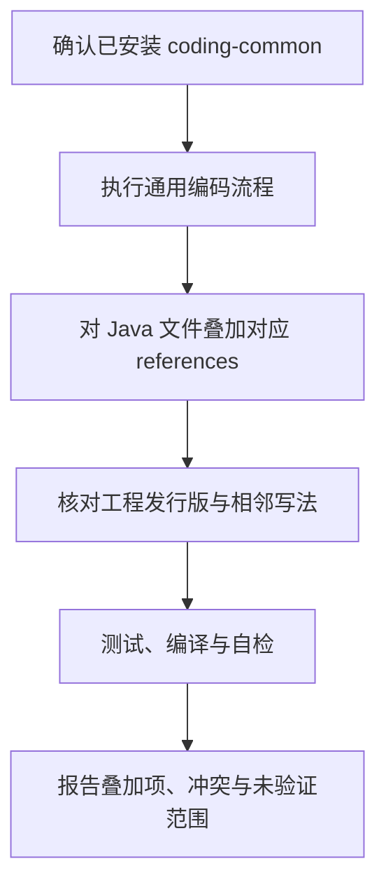

# coding-java：Java 编码约定补充

在完整执行 `coding-common` 的基础上，为 `.java` 改动补充命名、不可变值对象、Optional、领域异常、构造器注入、测试和查询安全约定。当前仓库写法优先，Java 新语法受项目发行版限制。

## 触发提示词

“写 Java”“按 Java 规范改”“补这个类”“JUnit”“record”“Optional”“构造器注入”，以及 `coding-java`、`AssertJ`、`Mockito`、`sealed`、`PreparedStatement`。

> 用 coding-java 补充订单服务的查找方法，订单不存在时明确失败。

> 给这个 Java 类补测试，沿用项目已有的 JUnit 写法。

提示词需要结合 Java 修改意图判断。纯文档、提交、视觉设计和会话钩子配置不在范围内。

## 内部流程

1. 从当前会话确认并加载 `coding-common`；不存在或不可调用时停止，不把仓库同名文件当作已安装。
2. 执行其完整流程，包括对齐仓库、范围判断、行为变更先红后绿、安全及完成前自检。
3. 实现阶段叠加 Java style，缺少现成结构时再读 patterns；验证阶段读 testing；安全敏感时读 security。只采用与仓库不冲突的缺省。
4. 从 Maven 或 Gradle 配置读取发行版。switch 表达式最低 14，文本块 15，record 和 instanceof 模式匹配 16，sealed 17，switch 模式匹配 21。读不到发行版时只用相邻代码已出现的语法。
5. 明确失败的服务查找抛领域异常；仓储查无记录可以返回 Optional，再由服务转换。Optional 不作为字段或参数，不在未确认有值时直接 get。

## 路由与失败处理

| 条件 | 行为 |
| --- | --- |
| 修改 `.java`，含测试 | 叠加 Java references |
| 只读 pom.xml、build.gradle 或 build.gradle.kts | 用于发行版和命令取证，不套 Java 类型命名规范 |
| 发行版不支持目标语法 | 用已有类、字段和分支，不抬高构建版本 |
| 缺少测试、编译、校验工具 | 记录未验证；不自动安装框架、插件或新增构建脚本 |
| 范围外文件要改成 record 或统一风格 | 保留原样，列入未扩大的范围 |

不强推示例仓储、响应信封或构建器。JDBC 查询使用参数绑定并关闭资源；日志和错误响应区分内部细节与对外信息。

## 输出与文件导航

完成说明固定为五项：**行为、命令、叠加、跳过、未扩大的范围**。命令记录实际退出码；未执行写原因。不会自动配置格式化、编辑器或钩子，也不提交用户未要求的 commit。

- [SKILL.md](SKILL.md)：依赖、发行版、流程与回复格式。
- [style.md](references/style.md)：命名、值对象、Optional、异常与校验。
- [patterns.md](references/patterns.md)：无现成约定时的仓储、服务与边界结构。
- [testing.md](references/testing.md)：已有 JUnit、断言、mock 和集成测试的沿用方式。
- [security.md](references/security.md)：查询、密钥、输入和错误响应。
