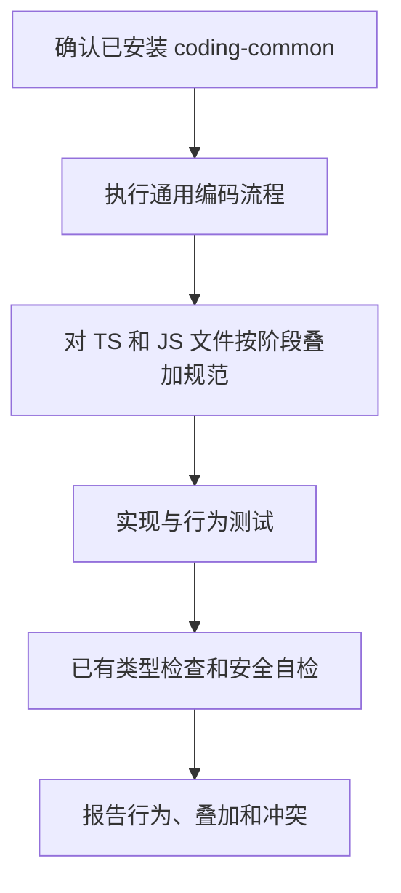

# coding-typescript：TypeScript / JavaScript 编码约定补充

在 `coding-common` 的完整编码流程上，为 `.ts`、`.tsx`、`.js`、`.jsx` 补充类型、边界校验、异步错误、React props、测试与安全缺省。已有模块和相邻代码的写法优先，不借机迁移语言或更换工具链。

## 触发提示词

“写 TypeScript”“补类型”“用 Zod 校验”“改这个组件”“TS 重构”“按 TS 规范改”，以及 `coding-typescript`、`Zod`、`React props`、`type narrowing`、`Playwright`。

> 为这个 TypeScript API 补充输入校验，沿用项目已有校验库。

> 修复这个 React 组件的 props 类型和异步错误处理。

关键词结合实际编程意图判断；纯文档、提交、视觉设计或钩子配置不在范围内。

## 内部流程

1. 先确认当前会话可调用 `coding-common` 并读取执行；缺失时停止，不使用仓库同名副本替代。
2. 按通用流程对齐仓库、判定范围，并在行为变更时先运行有效失败测试，再完成最小实现。
3. 实现阶段读取 style，需要默认 API、Repository 或 React Hook 结构时读 patterns；验证阶段读 testing；安全敏感时读 security。
4. 公开 API、共享模型和组件 props 类型明确；外部数据先收窄 unknown，异步错误按 unknown 处理，应用代码不留 any 或生产调试日志。
5. 沿用已有校验库和其版本。没有校验库时按入口失败分支做手写收窄，不为采用示例而自动安装 Zod。

## 路由与失败处理

| 条件 | 行为 |
| --- | --- |
| 本次触及 TS/JS 文件，含测试 | 同时采用通用和语言 references 中不冲突的缺省 |
| 仓库写法与示例类型、响应信封或 Hook 模式冲突 | 跟随仓库并说明跳过项 |
| 范围外 JS/JSX 被建议整文件迁成 TS | 不迁移，记入未扩大的范围 |
| 测试文件进入 tsconfig include 并引入运行器类型错误 | 移到 include 外或既有测试目录，不改 tsconfig 或安装类型依赖掩盖 |
| 没有测试或类型检查命令 | 明确写未运行和原因，不新增工具链 |

本技能不是完整编码流程的替代品，也不会配置 Prettier、编辑器或会话钩子。

## 输出与文件导航

完成说明固定为 **行为、命令、叠加、跳过、未扩大的范围**。命令逐项列实际退出码，未执行则列原因。

- [SKILL.md](SKILL.md)：依赖、叠加时机和失败分支。
- [style.md](references/style.md)：公开类型、interface/type、React props、不可变更新与异步错误。
- [patterns.md](references/patterns.md)：API、Repository 和 React Hook 的缺省形状。
- [testing.md](references/testing.md)：单元、集成、关键用户路径和类型检查。
- [security.md](references/security.md)：密钥及 TS/JS 特有的安全检查。
