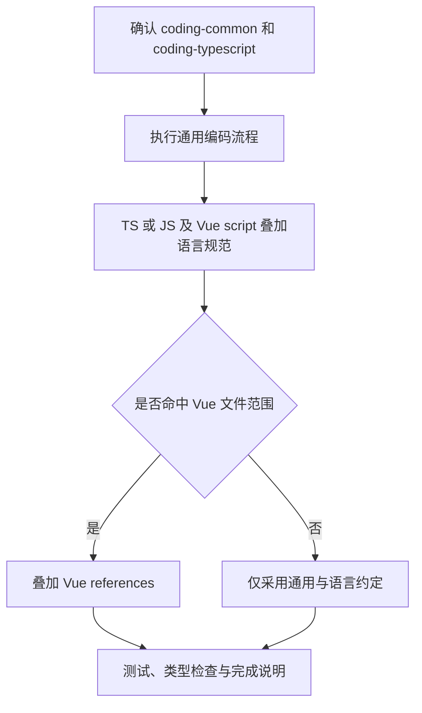

# coding-vue：Vue 编码约定补充

在通用编码和 TS/JS 约定上，补充 Vue SFC、Composition API、响应式、composable、Pinia、路由、查询缓存、组件测试和模板安全。只对本次命中的 Vue 文件应用，不把整个项目改造成另一套架构。

## 触发提示词

“写 Vue”“用 script setup”“写 composable”“改 Pinia store”“配路由守卫”“接 vue-query”“补组件测试”“修响应式丢失”，以及 `coding-vue`、`Vue 3`、`defineModel`、`Vitest`。

> 修复这个 Vue 组件解构 store 后不再更新的问题。

> 用 coding-vue 实现这个组件，数据来源沿用相邻组件的 props。

纯文档、提交、视觉设计和会话钩子配置不属于本技能。

## 内部流程

1. 必须确认两项依赖已安装且当前会话可调用；缺失时在改文件前停止。
2. 完整执行 `coding-common`；涉及 TS/JS 或 `.vue` 内 script 时读取已安装 `coding-typescript` 对应 references。
3. 命中 Vue 范围时，实现读 style，缺少结构时读 patterns，验证读 testing，安全敏感读 security。仓库相邻约定优先。
4. 新组件缺省用 `<script setup lang="ts">` 和 Composition API；不迁移无关 Options 组件。数据来源跟随相邻组件；只有用户点名或相邻组件已读 store 时才改用 store。
5. 检查 ref/reactive 的使用、computed/watch、生命周期、宏、props/emits、列表 key 和模板分支；store 解构采用 storeToRefs，避免丢失响应式。

## 文件路由条件

命中任一条件才叠加 Vue 规范：

- 路径以 `.vue` 结尾。
- 从 `vue` 导入 ref、computed、watch、watchEffect、defineComponent，或 `on` 后接大写字母的标识符。
- 文件导出函数名以 `use` 后接大写字母开头。
- 从 `pinia` 导入 defineStore/storeToRefs，或从 `vue-router`、`@tanstack/vue-query` 导入任意标识符。

未命中的普通 TS/JS 文件只采用通用和语言约定，不附加 SFC、Pinia 或模板规则。

## 失败处理与输出

- 无消毒库时不写不可信 `v-html`，不新增依赖；需要隔离时用 `sandbox=""` 的 iframe 并说明原因，否则不绑定这段 HTML。
- 没有 vue-tsc、测试命令或缺依赖时报告实际状态和未验证行为，不自动安装工具或新增 tsconfig。
- 完成说明列行为与验证结果、Vue/TS 叠加项、因仓库约定跳过项、props/store 选择，以及 iframe 的选用原因。
- 不强推示例 FSD、store、路由或查询方案，不配置编辑器和钩子。

## 文件导航

- [SKILL.md](SKILL.md)：依赖、文件路由和完整控制流。
- [style.md](references/style.md)：SFC、响应式、宏和模板。
- [patterns.md](references/patterns.md)：composable、props/emits、注入、Pinia、路由和查询。
- [testing.md](references/testing.md)：渲染、异步、store、composable 和类型检查。
- [security.md](references/security.md)：模板信任、HTML、URL、样式及客户端密钥。
