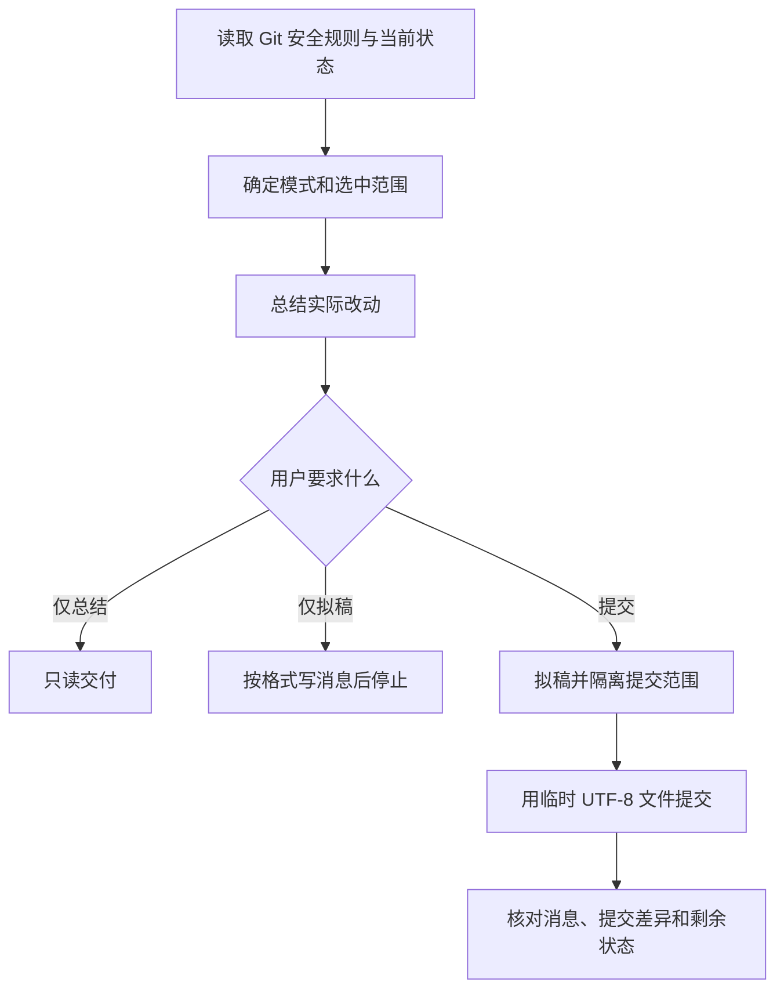
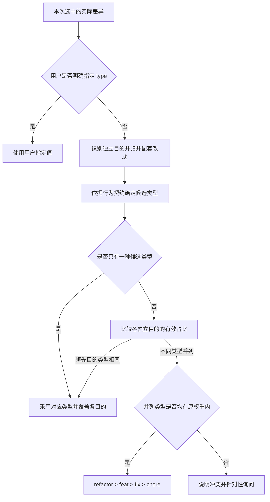

# commit-helper：总结改动、拟稿与提交

根据实际选中的 Git 改动总结意图、撰写结构化提交信息，并仅在用户要求提交时创建 commit。重点是提交内容、消息和授权范围一致，同时保留其他暂存与工作区改动。

## 触发提示词

“提交”“写提交信息”“创建 commit”“总结改动并提交”“帮我提交”“拟定提交说明”，以及 `commit-helper`、`git commit`、`commit message`。

> 总结当前暂存改动，拟一份提交说明，不提交。

> 使用 commit-helper，提交这次登录修复，保留其他暂存内容。

仅调用技能不等于授权提交；自然语言中的“总结”“拟稿”“提交”决定执行深度。

## 内部流程

1. 先读 git-safety，并行检查 status、未暂存差异、暂存差异及最近 15 条日志。日志只参考措辞习惯，消息结构仍按本技能要求。
2. 优先使用用户范围。拟稿或提交没有指定范围时优先已有暂存内容；没有暂存时选明确相关的一组，多组无关改动无法判断才询问。
3. 对选中新文件先读内容，敏感文件先筛查。报告密钥疑点时只列路径，不打印值。
4. 从实际差异总结“改了什么、为什么”，再生成 `<type>: <title>`、空行和 `- ` 条目；用户指定 type 时沿用，否则按改动主要意图选类型。
5. 提交前选择适合完整暂存区、指定已暂存路径或整文件的隔离策略，避免把无关暂存一并提交。消息通过临时 UTF-8 文件传入，避免引号和特殊字符被 shell 展开。
6. 成功后读取实际提交消息、文件和差异及 Git 状态，核对范围与用户改动仍被保留。

## 提交 type 如何路由

type 根据**本次选中提交的实际差异**选择，不根据整个工作区、提示词中偶然出现的单词或最近一次提交猜测。每次只选一个 type，顺序如下：

| type | 适用改动 | 判断边界 |
| --- | --- | --- |
| `fix` | 恢复既有契约 | 纠正实际行为与已有预期的偏差，不限改动大小 |
| `feat` | 改变预期能力契约 | 有意新增、扩展、改变或移除受支持能力，小功能也成立 |
| `docs` | 解释用法或行为 | 纯说明；修改技能执行规则不能仅因文件为 Markdown 就归此类 |
| `ci` | 调整持续集成 | 流水线、任务和测试矩阵，可包含对应说明 |
| `refactor` | 保持行为的内部调整 | 保持对外契约和行为，调整结构、职责或实现，不限大小 |
| `style` | 只改样式或格式 | 不改变业务逻辑 |
| `perf` | 性能优化 | 以性能改善为目的，必要结构调整随之归类 |
| `test` | 独立测试变更 | 为修复或功能配套的测试归入对应目的 |
| `build` | 构建或工具 | 构建、打包或工具调整，与 CI 编排和产品能力区分 |
| `revert` | 回退已识别的改动 | 需有撤销意图和历史证据，普通能力删除不自动归此类 |
| `chore` | 其他维护 | 无更具体目的的例行编码、版本、依赖维护，不是“不确定”的兜底 |

行为契约来自既有需求、公开接口、文档承诺、有效测试或已确认预期，包括返回值、错误、副作用和技能执行规则。处理指定暂存内容时，用差异基线或可追溯的既有需求/确认记录判断旧契约，用 index 版本判断本次行为；未暂存文档本身不能证明旧契约，也不能写成本次改动。当前实现或新增测试本身不能证明旧契约。无法确认是新需求还是旧缺陷时，先查已有证据，仍不明确再询问。

配套测试、说明、必要重构和生成文件归入所属目的；有额外独立结果的改动保留独立意图。“只改”指没有其他类型的独立目的，不限制文件种类。例如“修复空参数错误＋大量回归测试＋必要重构”仍是 `fix`；“新增退款功能＋必要代码移动”是 `feat`；“CI 矩阵＋对应说明”是 `ci`。

所有独立目的的 type 相同时直接采用该类型，正文覆盖各目的，不为选择 type 追问主次。例如安装说明和导出说明都属于 `docs`，可直接拟稿。类型去重不合并独立目的，也不累加其权重。

存在不同类型时比较各独立目的直接行为、职责或实现路径的有效改动占比，不按原始文件数、行数投票，不让生成内容和机械格式化放大权重。无法可靠分出主次时视为并列；领先目的的类型去重后只剩一种则直接采用，仍有不同类型时，仅当它们都在 **`refactor` > `feat` > `fix` > `chore`** 内才使用原权重。小规模独立重构不能压过主导的新功能。

涉及其他类型的未决平局，说明冲突并问一个针对性问题，不默认 `chore`、不补全总排序、不自动拆分提交。用户明确指定 type（包括自定义值）仍优先。混合改动在消息外用一句话解释选择依据，正文仍覆盖其他已选中的独立目的。

消息仍统一为 `<type>: <title>`、空行和至少一条 `- ` 摘要。type 的选择不改变“仅总结 / 仅拟稿 / 实际提交”的权限边界。

## 路由与停止条件

| 条件 | 行为 |
| --- | --- |
| 仅总结或拟稿 | 在对应阶段停止，不暂存、不提交 |
| 无选中差异 | 说明为空后停止，不造空提交 |
| 检查失败、冲突或正在 merge/rebase/cherry-pick | 修改前停止并报告；初始仓库无日志本身不是异常 |
| 选中内容与无关暂存无法安全隔离 | 保留 index 和现场，说明重叠，不扩大范围 |
| hook 改动了无关内容或出现配置、签名等失败 | 报告，不自动暂存、回滚、绕过检查或反复重试 |
| 需要 amend、push 或绕过 hook | 按明确授权处理，普通提交失败不授予这些权限 |

## 输出与文件导航

交付改动摘要、实际提交命令或完整消息，以及提交后状态；未提交模式提供对应摘要或草稿。不更改 Git 配置，不替换原 index，不自动建分支。

- [SKILL.md](SKILL.md)：模式选择和完整流程。
- [commit-message-format.md](references/commit-message-format.md)：消息类型、结构和安全传递示例。
- [git-safety.md](references/git-safety.md)：提交、amend、push 与敏感内容授权。
- [staging-and-hooks.md](references/staging-and-hooks.md)：范围隔离、临时 index、hook 和失败出口。
