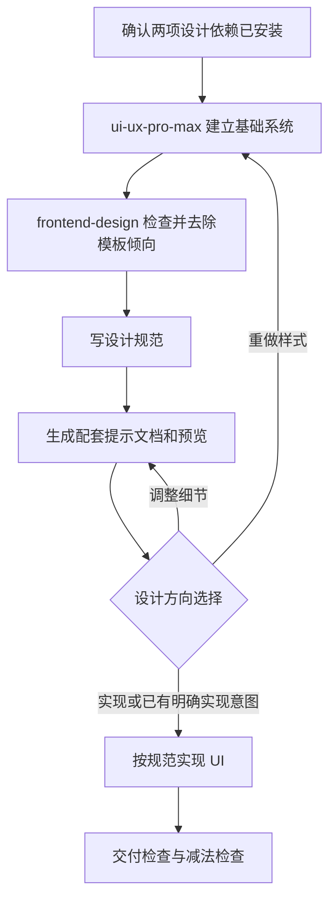

# designer：从设计方向到 UI 原型

编排 `ui-ux-pro-max` 和 `frontend-design`：先建立可用的设计系统，再检查设计是否贴合主题、是否落入模板，随后产出规范和预览，按用户意图继续实现。它负责连接设计流程，不替代两项依赖的专业内容。

## 如何触发

入口设置了 `disable-model-invocation: true`，应显式调用。例如：

> 使用 designer，为摄影作品集设计首页，先给设计规范和桌面、移动端预览。

> 使用 designer，为这个产品搭建 UI，直接实现可交互原型。

“先给设计”与“直接实现”决定预览后是否等待；仅提到 UI 不代表宿主必然自动调用本入口。

## 内部流程

1. 检查两项依赖在当前会话已安装且可调用。通过后自动执行到规范与预览，不另问是否开始。输入为空才询问主题、受众和页面任务。
2. `ui-ux-pro-max` 产出行业适配、页面结构、颜色、字体、交互和应避免的模式。
3. `frontend-design` 针对同一方案检查主题、首屏、字体、结构和文案，确定一个记忆点与有理由的审美冒险。没有主题依据的默认配色或版式需要修正。
4. 合并结果写入 `designs/specs/{slug}.md`，作为后续预览和代码的权威依据；复杂实现说明按需另写 `{slug}-implementation.md`。
5. 每个视图先写 `designs/images/{slug}-{view}.md`，再生成 `designs/previews/{slug}-{view}.png` 并更新规范索引。默认桌面和移动端，单一设备任务例外。
6. 用户选择实现后读规范及配套预览再编码。视觉方向由 frontend-design 负责，响应式、对比度、触控、焦点等工程约束由 ui-ux-pro-max 负责。
7. 完成时进行交付检查，并删除或简化一个无实际作用的装饰，保留已批准的核心特征。

## 提示词与内部路由

| 输入或反馈 | 后续行为 |
| --- | --- |
| “直接实现”“build UI”“搭建 UI”“按这个方向实现” | 展示规范和预览后继续实现；若明确要求停在设计则等待 |
| 选项 1：按方向实现 UI 原型 | 进入实现与交付检查 |
| 选项 2：重新调整样式 | 清理本轮该 slug 的规范、配对预览和图片说明，返回基础设计 |
| 选项 3：调整设计图细节 | 同步更新图片说明和预览，再回到方向选择 |
| 两项依赖缺失 | 停止，不使用仓库副本或自由设计代替 |
| 所有图片后端失败 | 报告具体失败，按 reference 允许仅带规范进入用户选择，不伪造预览 |

Codex 优先使用 Image Gen；其他宿主按可用的 image-gen MCP、GenerateImage 或多模态能力处理。预览和提示文档保持同名配对。当前入口缺失依赖提示里保留了 `upgrade:design` 旧命令，但根 package.json 没有该脚本；不能把该提示当成可用安装入口。

## 文件导航

- [SKILL.md](SKILL.md)：编排顺序、三个用户选项与边界。
- [design-brief-output.md](references/design-brief-output.md)：基础系统和修订方向格式。
- [detemplating-critique.md](references/detemplating-critique.md)：主题、记忆点及模板倾向检查。
- [spec-artifacts.md](references/spec-artifacts.md)：规范路径、权威关系和重做清理。
- [design-preview.md](references/design-preview.md)：图片后端、预览生成和配对更新。
- [implementation-guardrails.md](references/implementation-guardrails.md)：响应式、触控、可访问性和动效。
- [delivery-checklist.md](references/delivery-checklist.md)：交付和减法检查。
