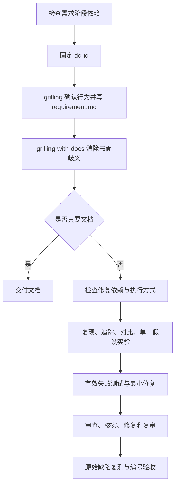

# dev-debug：从缺陷报告到修复验收

先确认缺陷的可观察行为，再调查根因、通过 TDD 修复，最后完成审查反馈和验收。只修复文档中已编号且用户已确认的行为，不把用户猜测直接当成根因，也不顺手修相邻问题。

## 如何触发

入口设置了 `disable-model-invocation: true`，应显式调用。例如：

> 使用 dev-debug，排查订单列表一直转圈的问题，走到修复验收。

> 使用 dev-debug，先把这个缺陷确认成需求文档，不改代码。

普通“有 bug”描述不是本入口自动调用的保证。

## 内部流程

1. 需求阶段确认已安装的 grilling、grilling-with-docs 和 domain-modeling。接受的缺陷标识固定为 `DD-<YYMMDD>-<feature-name>`，名称描述现象，不预设原因。
2. 单独用 grilling 澄清并确认行为，写 `docs/<dd-id>/requirement.md`，包含用户原话、已确认行为编号、非目标和未决。冲突规则先确定如何合成或取舍。
3. 使用 grilling-with-docs 检查书面歧义，它加载 domain-modeling 收术语和决策。已明确条目不重开；未决为“无”才进入修复。
4. 修复前选择当前会话修复与独立审查、分别用子代理修复与审查，或全部当前会话自审；已有选择沿用。拒绝子代理或派发不可用时按 reference 转自审并披露。
5. 按 systematic-debugging 复现、收集证据、对比正常路径、单一假设实验。失败前提不能传给后续步骤。
6. 先运行能因原始缺陷失败的测试，再做最小修复和相关回归；已有有效失败测试可复用。导入错误、环境缺失或零测试不是有效红灯。
7. 每个修复和整体差异都审查，反馈先核实再处理，最终建立“编号 → 原始复现 → 根因证据 → 红绿结果”的对应关系。

## 内部路由

| 条件 | 技能或行为 |
| --- | --- |
| 行为澄清 | grilling；此步不加载 domain-modeling |
| 书面歧义和术语 | grilling-with-docs → domain-modeling |
| 澄清中开始只读技术诊断 | 先加载 systematic-debugging；缺失只暂停诊断 |
| 进入修复阶段 | 检查 systematic-debugging、test-driven-development、requesting-code-review、receiving-code-review、verification-before-completion |
| 有审查反馈 | receiving-code-review 核实后处理；错误或越界建议不直接实施 |
| 行为改变或需扩展编号 | 回到 Step 3 确认，不能直接改代码 |

不调用 brainstorming 或 writing-plans，不写 proposal.md，也不另加计划或调查报告；技术证据保留在会话，必要事实摘要可标注后追加 requirement.md。

## 失败与恢复

- 无法复现或证据不足先补输入、日志与环境，不猜补丁或添加掩盖症状的兜底。
- 产品代码实验优先隔离进行；原位实验保存前态。无论成败先恢复本轮实验，再从缺陷基线 TDD；同状态已有有效红灯且实验就是最小修复时可直接验证绿灯。
- 恢复前重读，若与用户后续编辑重叠且不能安全分离，保留现场并暂停相关修复，不整文件覆盖。
- 同一缺陷实际修复三次失败后停止修补，讨论架构；调查假设实验失败不计入，换代理和续跑不清零。
- 无有效测试能力时停止受影响修复。重复审查争议无新证据时报告阻塞。

## 交付与文件导航

交付 requirement.md、修复编号、根因摘要、实际验证命令和结果、审查方式、未执行项与剩余问题。自审必须标明缺少独立审查；默认不建分支或提交。

- [SKILL.md](SKILL.md)：阶段、需求澄清和流程覆盖。
- [artifacts.md](references/artifacts.md)：标识、续跑和唯一缺陷文档。
- [fix.md](references/fix.md)：根因调查、实验恢复、TDD、审查和验收。
- [examples.md](references/examples.md)：多缺陷、执行方式和回归场景。
