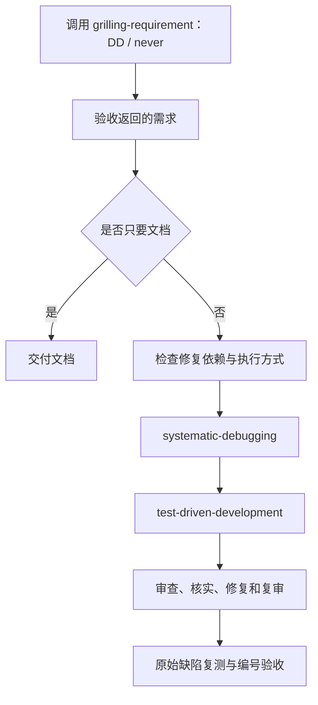

# dev-debug：从缺陷报告到修复验收

先确认缺陷的可观察行为，再调查根因、通过 TDD 修复，最后完成审查反馈和验收。只修复文档中已编号且用户已确认的行为，不把用户猜测直接当成根因，也不顺手修相邻问题。

## 如何触发

入口设置了 `disable-model-invocation: true`，应显式调用。例如：

> 使用 dev-debug，排查订单列表一直转圈的问题，走到修复验收。

> 使用 dev-debug，先把这个缺陷确认成需求文档，不改代码。

普通“有 bug”描述不是本入口自动调用的保证。

## 内部流程

1. 调用 grilling-requirement，传入完整输入、目标项目、已有 ID / 确认记录、缺陷类型及 DD / never；返回 task-id 记为 dd-id，续跑和变更回调沿用参数。
2. 验收 `docs/<dd-id>/requirement.md` 的已确认编号、书面澄清完成记录及「未决：无」。仅文档时交付；未满足验收时不进入修复。
3. 修复前选择当前会话修复加独立审查、分别派发修复与审查，或全部当前会话自审；已有选择沿用。拒绝子代理或派发不可用时转自审并披露。
4. 调用调查、测试、审查和验证技能；本入口维护范围、实验恢复和失败出口，不复述依赖技能的内部流程。最终交付编号对应的原始复现、根因证据与红绿结果。

## 内部路由

| 条件 | 技能或行为 |
| --- | --- |
| 行为澄清、书面歧义与术语 | grilling-requirement（pre-tag=DD、proposal-mode=never，缺陷任务） |
| 进入修复阶段 | 检查 systematic-debugging、test-driven-development、requesting-code-review、receiving-code-review、verification-before-completion |
| 有审查反馈 | receiving-code-review 核实后处理；错误或越界建议不直接实施 |
| 行为有未确认变化或需扩展编号 | 携原参数回调 grilling-requirement，重新验收后继续 |

不询问是否生成方案，不检查或调用 brainstorming，不调用 writing-plans，不创建或更新 proposal.md；目录里的既有方案原样保留。也不另加计划或调查报告；技术证据保留在会话，必要事实摘要可标注后追加 requirement.md。

## 失败与恢复

- 无法复现或证据不足先补输入、日志与环境，不猜补丁或添加掩盖症状的兜底。
- 产品代码实验优先隔离进行；原位实验保存前态。无论成败先恢复本轮实验，再从缺陷基线 TDD；同状态已有有效红灯且实验就是最小修复时可直接验证绿灯。
- 恢复前重读，若与用户后续编辑重叠且不能安全分离，保留现场并暂停相关修复，不整文件覆盖。
- 同一缺陷实际修复三次失败后停止修补，讨论架构；调查假设实验失败不计入，换代理和续跑不清零。
- 无有效测试能力时停止受影响修复。重复审查争议无新证据时报告阻塞。

## 交付与文件导航

交付 requirement.md、修复编号、根因摘要、实际验证命令和结果、审查方式、未执行项与剩余问题。自审必须标明缺少独立审查；默认不建分支或提交。

- [SKILL.md](SKILL.md)：阶段、需求澄清和流程覆盖。
- 公共契约见 [grilling-requirement](../grilling-requirement/README.md)。
- [artifacts.md](references/artifacts.md)：修复阶段续跑。
- [fix.md](references/fix.md)：根因调查、实验恢复、TDD、审查和验收。
- [examples.md](references/examples.md)：执行方式和修复回归场景。
