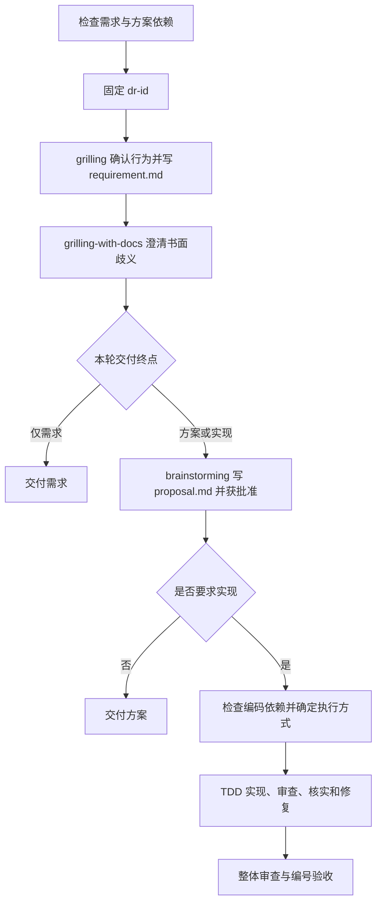

# dev-requirement：从功能需求到实现验收

将功能想法依次变成已确认需求、批准方案和可验证实现。用固定编号关联行为、代码、测试与审查，避免访谈结论在编码时被悄悄扩大。也支持只完成需求或方案文档。

## 如何触发

入口设置了 `disable-model-invocation: true`，应显式调用。例如：

> 使用 dev-requirement，梳理订单退款功能，只要需求文档。

> 使用 dev-requirement，为订单退款出方案并实现，按已经确认的执行方式继续。

这些是适用请求示例，不是自动路由保证。

## 内部流程

1. 需求阶段检查已安装的 grilling、grilling-with-docs、domain-modeling、brainstorming。缺失时停止，不用仓库同名目录替代或自动安装。
2. 固定 `DR-<YYMMDD>-<feature-name>`，例如六位日期加小写功能名；名称稳定可推得时直接宣布，多件独立功能或名称不唯一才问。接受后不随续跑变动。
3. 单独执行 grilling，确认共同理解后写 `docs/<dr-id>/requirement.md`。已确认行为编号，记录用户原话、非目标与未决；未决必须为“无”才继续。
4. 再用 grilling-with-docs 检查已落盘需求的歧义和冲突，不重问明确条目。它加载 domain-modeling，术语和决策写根 GLOSSARY.md 或 ADR，不替代需求文件。
5. 需要方案时调用 brainstorming，只写同目录 `proposal.md`，不写其默认 specs 目录；用户批准后才进入编码。不调用 writing-plans。
6. 将编号划为可验收任务。按有效红灯、最小实现、绿灯和回归顺序执行；任务与整体审查覆盖暂存、未暂存、新增文件及必要调用者。
7. 核实审查意见后修复、验证、复审，最后逐项对照编号验收；测试通过本身不代表需求全部覆盖。

## 条件路由与依赖

| 条件 | 技能或动作 |
| --- | --- |
| 初次需求访谈 | grilling |
| 书面歧义、术语与决策 | grilling-with-docs → domain-modeling |
| 形成方案 | brainstorming |
| 编码前 | 检查 test-driven-development、requesting-code-review、receiving-code-review、verification-before-completion |
| 实现和最终成功声明 | TDD、审查及完成前验证；有反馈才调用 receiving-code-review |
| 只要需求 | Step 3 后结束；当前入口仍要求通过需求阶段四项依赖检查 |
| 只要方案 | 方案批准后结束，不检查编码依赖 |
| 批准后行为变化或用户要采纳新增行为 | 回到需求编号确认，再更新并批准方案 |

编码前执行方式未明确时问一次：当前会话实现、子代理独立审查；实现和审查分别使用子代理；全部当前会话执行并披露自审。已有选择直接沿用，拒绝所有子代理或派发不可用时按 reference 转为自审并披露。三种方式实现同一批编号。

## 阻塞与交付

- 两条需求互相冲突时先解决合成条件或取舍，不把推荐当作确认。
- 文档存在不等于用户已批准；明确续跑记录可复用，不按文件存在跳过澄清。
- 测试设施无法产生有效红绿时停止受影响产品代码实现；环境错误、零测试不算通过。
- 越界建议不阻塞独立范围内修复；范围内不确定且相互依赖的反馈先澄清。重复争议无新证据时停止，报告阻塞。
- 交付需求、方案的实际路径、已实现编号、验证命令与结果、审查方式和剩余项。不默认建分支或提交。

## 文件导航

- [SKILL.md](SKILL.md)：阶段、依赖、调用覆盖规则。
- [artifacts.md](references/artifacts.md)：标识、续跑和两份文档内容。
- [implement.md](references/implement.md)：执行方式、TDD、审查反馈和最终验收。
- [examples.md](references/examples.md)：多功能、仅文档、依赖缺失和回归场景。
