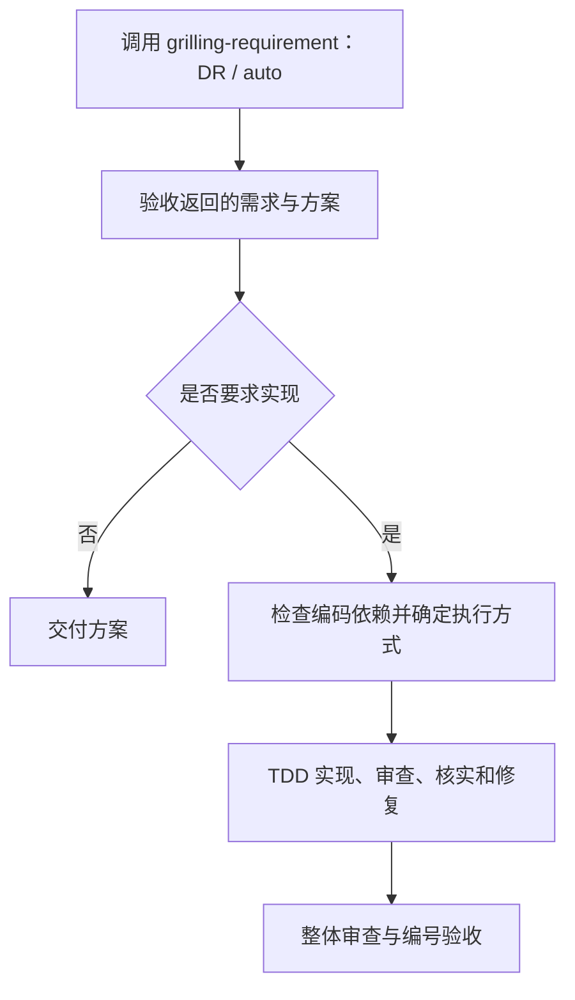

# dev-requirement：从功能需求到实现验收

将功能想法依次变成已确认需求、批准方案和可验证实现。委托 grilling-requirement 自动生成需求与技术方案，不询问是否生成方案；用固定编号关联行为、代码、测试与审查。支持只完成文档；用户明确禁止方案时尊重该限定。

## 如何触发

入口设置了 `disable-model-invocation: true`，应显式调用。例如：

> 使用 dev-requirement，梳理订单退款功能，只要文档，不实现。

> 使用 dev-requirement，为订单退款出方案并实现，按已经确认的执行方式继续。

这些是适用请求示例，不是自动路由保证。

## 内部流程

1. 调用 grilling-requirement，传入完整输入、目标项目、已有 ID / 确认记录及 DR / auto；返回 task-id 记为 dr-id。
2. 验收 `docs/<dr-id>/requirement.md` 的已确认编号、书面澄清完成记录及「未决：无」，并核对当前 `proposal.md` 已批准。仅文档时交付；待批准或阻塞时不进入实现。
3. 将编号划为任务，调用实现、审查和验证技能；本入口负责执行方式、范围、交接与失败出口，不复述依赖技能的内部流程。

## 条件路由与依赖

| 条件 | 技能或动作 |
| --- | --- |
| 取得需求与方案 | grilling-requirement（pre-tag=DR、proposal-mode=auto） |
| 编码前 | 检查 test-driven-development、requesting-code-review、receiving-code-review、verification-before-completion |
| 实现和最终成功声明 | TDD、审查及完成前验证；有反馈才调用 receiving-code-review |
| 只要文档 | 自动生成需求与方案，批准后交付，不检查编码依赖 |
| 明确只要 requirement.md、禁止方案 | 用户限定优先，改传 never，公共技能跳过方案后交付需求 |
| 只要方案 | 方案批准后结束，不检查编码依赖 |
| 批准后行为变化或用户要采纳新增行为 | 回到需求编号确认，再更新并批准方案 |

编码前执行方式未明确时问一次：当前会话实现、子代理独立审查；实现和审查分别使用子代理；全部当前会话执行并披露自审。已有选择直接沿用，拒绝所有子代理或派发不可用时按 reference 转为自审并披露。三种方式实现同一批编号。

## 阻塞与交付

- 文档存在不等于用户已批准；明确续跑记录可复用。验收不满足或内容有未确认变化时，携原参数回调 grilling-requirement。
- 测试设施无法产生有效红绿时停止受影响产品代码实现；环境错误、零测试不算通过。
- 越界建议不阻塞独立范围内修复；范围内不确定且相互依赖的反馈先澄清。重复争议无新证据时停止，报告阻塞。
- 交付需求、方案的实际路径、已实现编号、验证命令与结果、审查方式和剩余项。不默认建分支或提交。

## 文件导航

- [SKILL.md](SKILL.md)：阶段、依赖、调用覆盖规则。
- 公共契约见 [grilling-requirement](../grilling-requirement/README.md)。
- [artifacts.md](references/artifacts.md)：方案交接与实现续跑。
- [implement.md](references/implement.md)：执行方式、TDD、审查反馈和最终验收。
- [examples.md](references/examples.md)：调用衔接、仅文档、依赖缺失和回归场景。
