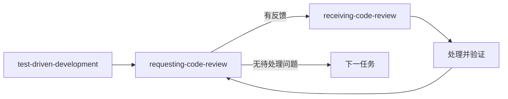

# 实现

只在主流程第 2 节读取：`proposal.md` 已获批准，且用户要求继续实现。

## 1. 编码依赖与执行方式 ⛔ BLOCKING

按主流程的登记入口规则检查以下四项；缺失或不可读时停止编码，保留文档，提示 `npm run upgrade:skill -- --skill <缺失技能名>` 后部署并确认会话可调用；不自动安装。调用后遵守对应技能，本文件仅规定交接与流程覆盖。

| 已安装技能 | 调用时机 |
| --- | --- |
| `test-driven-development` | 写测试与产品代码前 |
| `requesting-code-review` | 每个实现任务及整体完成时 |
| `receiving-code-review` | 有审查反馈、修改前；无反馈不调用 |
| `verification-before-completion` | 编码开始及最终验收 |

未指定执行方式时，写产品代码前问一次并等待；已有明确选择直接沿用，不再问是否开始：

```text
按 proposal.md 实现 requirement.md 里的已确认编号，选择哪种执行方式？
1. 当前会话实现，独立子代理审查（推荐）
2. 实现与审查均用子代理，由不同代理承担
3. 全部在当前会话执行（自审，缺少独立审查）
```

三种方式覆盖同一批编号。用户回答「否」或拒绝所有子代理时选 3；沿用旧式「是」时选 2。派发能力不可用时告知并转为 3。方式 3 是对 requesting-code-review 强制派发要求的显式覆盖：仍加载其模板并自审，报告独立审查未执行，不能冒充独立审查通过。

## 2. 固定实现范围

重读两份文档及当前工作区、暂存区，保留用户后续编辑。文档变化若影响已批准行为或方案，先回到对应确认步骤，不能把磁盘上的新内容自动当成已批准。

按编号行为划分可验证任务，在当前会话记录「任务 → B 编号 → 文件范围 → 验证命令」，不新增计划文档或调用 writing-plans。记录任务开始时的文件状态，作为本轮改动和既有改动的分界；不创建分支或提交，除非用户明确要求。

派发时不继承会话历史，提供 dr-id、两份文档路径、任务的编号原文、方案约束、文件边界、依赖登记入口、验证命令及本文件。实现者报告编号、改动与测试证据；协调者核对实际差异和结果，不照抄成功声明。实现代理不得代替独立审查者。

## 3. 每个任务：TDD → 审查 → 反馈闭环



**测试边界。** 已有行为和有效测试先验证复用，不为制造红灯破坏已有实现。错误导入、缺依赖、运行器不可用不是预期失败；零测试不是通过。优先使用项目已有设施或语言内置测试工具，不自动引入新框架。仍不能运行有效测试时停止受影响实现，报告阻塞，不以「未验证」代替测试门禁。

**审查。** 加载 requesting-code-review 及其模板。提交给审查者的材料包含编号原文、方案约束、准确差异、测试命令与结果、已知缺口。覆盖本轮暂存、未暂存及新增文件内容，和必要调用方上下文；以任务开始状态区分既有用户改动。仅在真实提交范围完整覆盖本轮内容时才用 BASE/HEAD；不能照搬 `HEAD~1..HEAD` 漏掉未提交文件，不能为审查创建提交。审查只读，不改工作区或暂存区。

**反馈。** 有反馈先加载 receiving-code-review，再对照代码和已确认行为核实：

| 结论 | 动作与出口 |
| --- | --- |
| 成立的范围内缺陷 | 调用 test-driven-development 修复；非行为性修改用对应检查验证，之后复审 |
| 错误建议，或明确违反已批准行为 | 提供代码或测试证据，交审查者复核，不盲改；已确认行为明确时不重问同一决定 |
| 含糊、无法验证且影响现有行为判断 | 说明缺失证据，暂停受影响修复并澄清；不能确认相互独立时暂停整组反馈 |
| 审查者提出新行为或扩大范围 | 记录为本轮不采纳，继续原范围修复；用户明确要求采纳时按主流程回调 grilling-requirement，重新满足返回验收后继续 |

这是对 receiving-code-review「任一反馈不清楚就停止全部实现」的范围限定：已明确越界的建议不是未澄清需求。判断各项是否相关后，可继续证据充分且独立的范围内修复；范围内的真实疑点仍阻断相关实现，不能以分组为由忽略它。

逐项处理后运行相关回归，带着处理结论和证据复审。成立的 Critical / Important 未解决时不得进入下一任务或宣称完成；Minor 明确记录处理或保留理由。复审出现新问题继续同一闭环；重复反馈没有新证据时报告争议和阻塞，不盲目重试或自行宣称通过。审查模板对合理预期的要求用于发现问题，不授权扩展已确认编号。

## 4. 整体审查与最终验收

所有任务完成后再审查整体差异，检查编号覆盖和任务间集成；有反馈仍走上述闭环。只有一个任务且范围与最终文件状态完全一致时，任务审查可兼作整体审查。

用 verification-before-completion 对最终代码状态完成核对：

- 每个 B 编号都有实现位置和验收证据；测试通过不自动等于需求全部满足。
- 执行与改动相称的测试、构建和静态检查，读完整输出、退出码及测试数量。本编排对 verification-before-completion 的重复运行要求作显式覆盖：仍对应最终状态且覆盖充分的本轮证据可复用；后续修改使证据失效时重跑受影响检查，不沿用往轮结果。
- 核对实际差异，保留用户既有及后续编辑；同步目标仓库要求的文档。
- 交付列出已实现编号、实际验证命令与结果、未执行检查、环境阻塞、审查方式及剩余问题。自审标明独立审查未执行；阻塞或未验证不能表述为全部完成。
