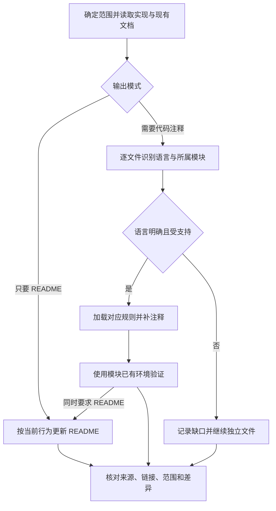

# doc-helper：从实现补全文档

读取当前代码和调用链，逐文件识别语言，为公开 API 补充对应格式的文档，在关键步骤说明原因，并按请求创建或更新 README。首期支持 JS/TS、Java、Python、C/C++。只描述已有且有依据的行为，不把计划、类型声明或命令名称当成已实现、已运行的证据。

## 触发提示词

“补全文档”“写注释”“完善 README”“代码注释”“文档补全”，以及 `doc-helper`、`JSDoc`、`Javadoc`、`docstring`、`Doxygen`、`document code`、`add comments`。

> 给这个模块补充 JSDoc，区分同步抛错和 Promise 拒绝。

> 给 Java、Python 和 C/C++ 的公开接口补注释，保留各模块现有风格。

> 只更新 README 中的配置和使用示例，不改代码注释。

> 只给 retry 函数体补关键步骤行内注释，不加 JSDoc，也不处理其他函数。

## 内部流程

1. 按请求确定输出类型及具体文件、符号、代码区域或 README 章节，排除的阶段不执行。读取适用项目指令、入口、公开接口、所属模块配置和既有文档；逐文件识别语言，不能用根目录技术栈代替混合项目判断。读取周边代码取证不等于可以修改它，用户已给范围时不重复询问。
2. 请求符号文档时，范围内公开 API 至少有简短说明；参数、返回、字段、常量和错误补充签名未表达的语义。内部仅处理范围内的复杂逻辑或重要约束，保留有效注释，不凑标签。
3. 按需加载语言规则：JS/TS 区分同步抛错与异步拒绝；Java 区分抛异常与 Future 异常完成；Python 区分返回、产出、等待结果与异常；C/C++ 说明返回码、指针边界、所有权及适用的异常语义。
4. 行内注释解释非显然分支、资源生命周期、并发顺序等关键原因。表达式回调不为了注释改写函数体；保留工具指令和宏续行。
5. README 面向入口、使用、配置、目录和例子；符号细节留在代码中。按对应构建配置核对命令，保留语言、结构和无关内容。
6. 在模块已有环境中执行适用检查，不自动安装工具、切换全局环境或改配置。修正本轮注释导致的问题；其余失败、工具缺失和未执行项分开报告。重复执行不为措辞或排版产生新改动。

## 路由与取证

| 条件 | 行为 |
| --- | --- |
| README only | 只执行调查、README、自检；读源码但不修改源码 |
| 仅符号文档，如 JSDoc / docstring | 调查、所选语言的符号文档、自检，不添加函数体注释 |
| 仅行内注释 | 调查、所选语言的语法与位置规则、关键步骤注释、自检，不补符号文档 |
| 一般代码注释 | 默认包含符号文档与关键行内注释；仅项目指令明确要求且用户未排除时同步 README |
| 两者或一般文档任务 | 执行完整流程，但仍受指定范围限制 |
| `.h` 等文件语言有歧义 | 核对构建配置、语法和包含关系；仍无法确定则保留原文件、局部询问并继续其他文件 |
| 要求修改 Ruby、Rust 等未支持语言的代码注释 | 跳过并报告部分完成，不套用 JSDoc；仅更新 README 时仍可读这些源码取证，不因语言未支持误报部分完成 |
| Python docstring 被代码用作命令等运行配置 | 保留该符号，说明消费者及影响并询问；普通文档元数据更新允许进行 |
| 涉及第三方 API 且本地证据不足 | 先核对安装或锁定版本，再查 Context7 或匹配版本的官方资料 |
| 外部资料不可用 | 使用可获得的本地权威证据，省略无依据结论并报告缺口 |
| 文档与实现冲突 | 追踪实现、调用者及测试；契约仍不明确时只问该问题，不顺手修代码 |

按请求粒度记录“已修改”“已检查且足够”或“未解决/跳过”。已足够而无需修改算完成；同一文件中只要还有必需符号未处理，仍是部分完成。取证文件和用户排除的输出不算遗漏项。

这里没有强制的编码技能依赖。Context7 是条件性取证工具，不是每次都调用的必经步骤。覆盖情况与验证结果分别报告：缺工具时注明“已修改/检查；对应环境验证未执行”，不能宣称全部验证通过。

## 默认格式与语言

优先保留项目有效风格，不默认把普通注释批量转成文档标签。没有约定时：JS/TS 用 JSDoc，Java 用 Javadoc，Python 用 Google 风格 docstring，C/C++ 用 Doxygen。指定格式与代码语言不兼容时说明原因并采用对应语言格式。

新增注释语言按“用户要求 → 项目规范 → 文件或模块既有注释 → 项目主要文档语言 → 中文”决定。保留有效既有注释的语言，标识符和标准标签不翻译。

## 产物与边界

按用户模式交付注释、README 或两者。有维护中的译本且在范围内时同步事实。不会为模板创建额外 AGENTS、翻译或伴随文档，不改结构来迎合注释。Python 允许正常文档字符串改变 `__doc__`，不承诺运行时元数据完全不变；签名、控制流和业务表达式保持不变。

## 文件导航

- [SKILL.md](SKILL.md)：范围、模式、证据与兜底规则。
- [language-routing.md](references/language-routing.md)：逐文件识别、模块定位与已有环境选择。
- [jsdoc-conventions.md](references/jsdoc-conventions.md)：符号覆盖和错误语义。
- [java-conventions.md](references/java-conventions.md)：Javadoc、继承文档和异步异常。
- [python-conventions.md](references/python-conventions.md)：docstring、生成器与运行配置边界。
- [c-cpp-conventions.md](references/c-cpp-conventions.md)：Doxygen、C 返回码与 C++ 生命周期及异常。
- [inline-comments.md](references/inline-comments.md)：关键步骤注释与反例。
- [readme-guide.md](references/readme-guide.md)：README 内容、语言和验证。
