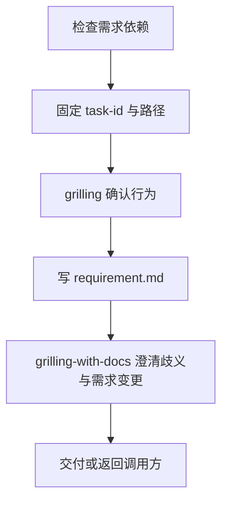

# grilling-requirement：公共需求澄清

把功能或缺陷描述变成已确认、可验收的编号行为，写入目标项目的 `docs/<task-id>/requirement.md`。单独调用在需求交付后结束；编排调用则返回调用方。

公共入口允许被其他技能调用；dev-requirement / dev-debug 仍保留各自的显式入口。实际加载以当前会话登记为准。

## 提示词与行为

| 提示词 | 行为 |
| --- | --- |
| 使用 grilling-requirement 梳理订单退款需求 | 默认 TK，例如 TK-20261028-order-refund |
| 使用 grilling-requirement，pre-tag=OPS，梳理告警规则 | 使用自定义前缀 OPS |
| 继续 TK-20261028-order-refund | 核对文档、确认记录和本轮输入，只补缺失阶段 |
| 继续原任务，新增一个行为 | 仅澄清变更及其影响；确认后局部更新，保留旧编号和无关内容 |
| 使用 dev-requirement / dev-debug | 调用方分别传入 DR / DD，需求完成后返回 |

新 ID 为 `<pre-tag>-<YYYYMMDD>-<feature-name>`，日期使用本轮开始日，跨午夜不改；feature-name 使用小写英文数字和单个连字符。前缀以字母开头、仅含字母数字，保留指定大小写。历史六位日期 ID 只在明确续跑时沿用，不自动迁移。

## 内部流程

依赖 grilling、grilling-with-docs、domain-modeling，使用会话登记入口，缺失时停止并提示部署。首次访谈与书面检查分开；确认后落盘，行为以 B1、B2 编号，未决为“无”才交付。已确认且不受变更影响的条目不重问。旧稿无歧义不代表新增行为已完成：先取得当前变更的确认，再接续编号写入，不能直接返回。术语和 ADR 不替代需求文件。

缺陷名称描述现象，用户猜测不当根因；只读技术诊断额外需要 systematic-debugging。公共技能不要求 brainstorming，不写方案或产品代码。冲突未解决、目标不可读或缺少确认记录时说明缺口；写前重读，保留无关内容及用户编辑。

- [SKILL.md](SKILL.md)：输入、依赖与步骤。
- [artifacts.md](references/artifacts.md)：ID、续跑和需求模板。
- [examples.md](references/examples.md)：边界与回归场景。
