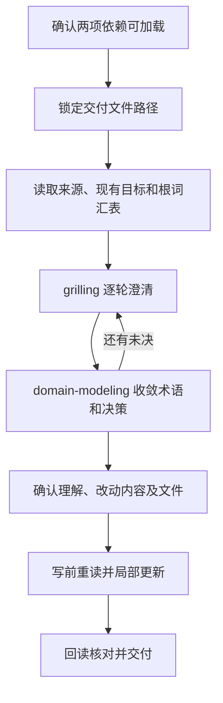

# grilling-with-docs：澄清需求后写入文档

将需求文本或指定文档变成双方确认的交付文件。先锁定输出位置，随后用 `grilling` 澄清歧义，用 `domain-modeling` 统一术语和决策，理解确认后才写主文档。

## 触发提示词

“拷问需求”“澄清歧义”“拷问后写文档”“先拷问再落盘”“需求访谈写文件”“明确输出路径”，以及 `grilling-with-docs`、`grill with docs`、`PRD grilling`、`interview then write spec`。

> 读取 docs/prd/orders.md，澄清需求后写到 docs/specs/orders.md。

> 完善 docs/prd/orders.md，先解决歧义，再更新确认过的段落。

“产物文件名”“写到哪个文件”是描述中的路由线索，仍需结合需求澄清与落盘意图判断。

## 内部流程

1. 从会话技能登记入口确认 grilling 和 domain-modeling 可加载，不以仓库同名文件代替。输入解析出需求文本、来源和交付线索。
2. 只有用户明确指定输出/更新角色，或接受建议路径，才锁定目标。仅读取、比较、示例或排除路径不能当作输出；缺失或歧义时问一次并等待，再开始材料读取与访谈。
3. 读取所有指定来源、已有目标和目标项目根 GLOSSARY.md，整理目标、非目标、角色、术语与未决。代码用于事实取证，不自动等于产品意图。
4. 首轮提问前同时加载两项依赖。按 grilling 的前沿轮次提问和等待；domain-modeling 同步检查术语冲突、场景与代码，并按它的条件提供 ADR。
5. 未决清空后，汇总决定、术语、来源替代或获准省略项，以及每个文件的新建/更新范围；确认共同理解后写入。明确“无需再问直接写”的输入可豁免该最终确认。
6. 写前重读，保留无关段落、元数据、链接及后续用户编辑。回读确认结果，重复请求已满足时不制造改动。

## 路由与写入时机

| 条件 | 行为 |
| --- | --- |
| 必需依赖缺失或加载失败 | 停止访谈和写入，说明缺失及具体错误 |
| 用户只给来源路径 | 询问交付目标，不能自行沿用来源路径 |
| 来源缺失、不可访问或仅部分读到 | 继续读取独立材料；获得替代材料或明确省略授权后才能访谈 |
| 不可读来源同时是更新目标 | 不触碰目标；省略来源不等于授权覆盖原文 |
| 术语在访谈中确定 | 可更新目标项目根 GLOSSARY.md；ADR 须满足 domain-modeling 三项门槛 |
| 词汇表或 ADR 本身就是主交付物 | 等最终确认后的写入阶段再落盘 |
| 普通文档全文替换 | 需要针对该路径的明确授权，普通“更新”不包含丢弃其余内容 |

词汇表固定为目标项目根 `GLOSSARY.md`，不另建上下文副本；只收术语，不把所有问答和实现细节倒进去。

## 产物与限制

交付锁定文件，以及实际发生的根词汇表/ADR 更新；报告实际读到的来源、替代、省略和用户延后项。当前入口缺失依赖提示引用了 `upgrade:tool`，但根 package.json 没有该脚本；不能照此提示认定安装命令可运行。

## 文件导航

- [SKILL.md](SKILL.md)：路径锁定、依赖加载和确认流程。
- [ingest-and-artifact.md](references/ingest-and-artifact.md)：路径角色、来源恢复和多文档读取。
- [deliverable-quality.md](references/deliverable-quality.md)：局部更新及 spec、brief、词汇表、ADR 的内容边界。
