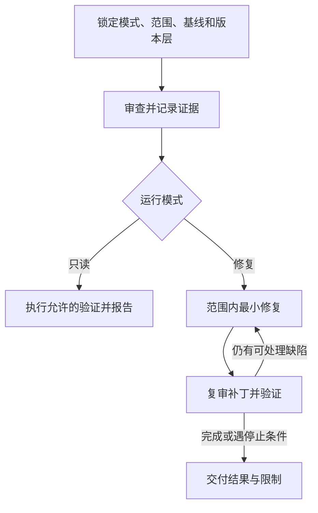

# review-helper：限定范围的代码审查与修复

解析用户指定的路径、提交和版本层，找出有证据的代码问题，以中文 P0–P3 报告，并按模式完成范围内修复、复审和验证。既可独立使用，也可作为外层编排中的只读审查者。

## 触发提示词

“审查”“代码审查”“检查改动”“修复审查问题”，以及 `review-helper`、`review`、`code review`、`PR review`。

> 使用 review-helper self，仅审查 src/auth，不修改代码。

> 检查当前改动并修复范围内问题，保留暂存区。

默认是**审查并修复**；“仅审查/只报告/不改代码”禁止修复，“不写文件”还会禁止报告落盘。

## 内部流程

1. 检查工作区、暂存区和 ref，固定比较版本，记录授权路径、排除项、文件数和报告位置。
2. 阅读完整差异及必要调用链，检查正确性、安全、实质性能和可维护性。每项说明触发、影响、真实版本位置、证据和简短建议；锁文件不提出发现，风格偏好不冒充缺陷。
3. 修复模式只改证实且范围内的问题，保留有效断言及用户改动。复审使用修复后的工作区，原比较版本留作审计，不因 index 仍保留旧内容而重复修复。
4. 按实际脚本、工作目录和前置步骤选择能覆盖相关行为的验证。被审版本不同于工作区时隔离完整执行上下文，不能拿工作区结果证明另一份快照。
5. 同一问题重试没有新证据或进展时停止；环境、无关失败和无测试入口分别记录，继续独立检查。

## 输入如何选择范围

| 输入 | 默认审查内容 |
| --- | --- |
| `self` | 相对目标/基线分支 merge-base 的完整分支差异，包括已推送提交；另含暂存差异 |
| 空参数 | 配置 upstream 到 HEAD 的未推送差异，加暂存差异 |
| 指定提交 | 该提交相对父提交的差异，加暂存差异；merge 提交需要明确比较父项 |
| 路径或“当前改动” | 路径内暂存、未暂存及相关新增文件 |
| `all` | 当前完整源码范围，按项目约定排除依赖、生成物和 vendor |
| 其他 ref 或范围 | 使用用户给定比较，不静默改成 HEAD |

显式路径过滤所有版本层。提交模式不会自动混入未暂存或新增文件；缺基线时澄清，不自动 fetch、checkout 或换比较对象。

## 内部路由与权限

- 单独调用无需额外依赖 Superpowers 技能，执行自己的审查与修复循环。
- 由 reviewer 等外层委派时读取 review-handoff，沿用传入模式、范围和版本；只读返回发现，不修复、不落盘报告、不派生代理。
- 基线不明、修复需越界或与用户改动冲突时，只暂停依赖该决定的部分，继续独立审查。
- 默认报告保存为 `.review/{timestamp}.md`；用户指定路径或禁写要求优先。
- 默认不暂存、提交、建分支，不改原 index，也不擅自 reset、stash 或 checkout 恢复。

## 交付与文件导航

报告包含模式与基线、各版本层、P0–P3 发现、修复和剩余项，以及实际验证命令、工作目录、版本、退出状态和覆盖限制。零测试、未运行或语法检查不能替代行为通过。

- [SKILL.md](SKILL.md)：主流程和两个运行角色。
- [scope-and-diff.md](references/scope-and-diff.md)：输入解析、比较版本和路径过滤。
- [report-format.md](references/report-format.md)：优先级、真实位置和报告格式。
- [review-handoff.md](references/review-handoff.md)：外层与独立审查者的输入输出契约。
- [verification-commands.md](references/verification-commands.md)：命令选择、隔离快照与验证分类。
