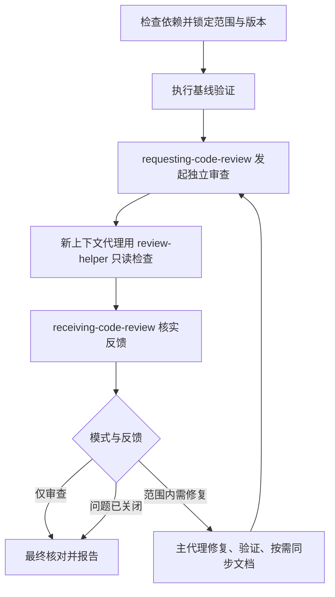

# reviewer：编排独立代码审查闭环

让主代理负责范围、反馈核实和修复，让独立代理只读审查。支持默认的审查并修复，也支持仅审查。在已授权范围内自动完成验证、修复和独立复审，不每轮重新申请许可。

## 如何触发

入口设置了 `disable-model-invocation: true`，应显式调用。例如：

> 使用 reviewer，审查当前改动并修复确认的问题。

> 使用 reviewer self，仅审查 src/auth，不写文件。

“仅审查/只报告/不改代码”禁止修复；“不写文件”同时禁止报告落盘。范围解析完全沿用 review-helper，不另设一套基线算法。

## 内部流程

1. 检查必需依赖，调用 review-helper 锁定任务并读取它的交接契约；此时不启动它的本地修复循环。
2. 记录需求、路径、基线、提交/暂存/工作区/新增内容和当前状态，运行所选版本的已有检查作基线，不先重写测试。
3. requesting-code-review 派发新上下文只读代理，明确使用 review-helper。交接准确内容标识和差异，不能只给 BASE/HEAD 而漏掉未提交文件，也不为获得 SHA 创建提交。
4. 独立代理按 P0–P3 返回发现和限制；不改文件、index 或 HEAD，不派生代理、不递归调用 reviewer。主代理维护唯一报告。
5. receiving-code-review 逐项核实。成立且范围内则最小修复，不成立则留反证，含糊、冲突或越界项只暂停依赖它的工作。
6. 每轮修复后验证、按需同步文档，再独立复审。确认的 P2/P3 也按授权处理，不能只清空高优先级问题。
7. 最终用 verification-before-completion 核对最后状态、编号覆盖、问题关闭证据和用户改动保留情况。

## 依赖与路由

| 技能 | 使用条件 |
| --- | --- |
| review-helper | 必需：范围、标准、报告、版本验证与交接 |
| requesting-code-review | 必需：组织上下文并派发每轮独立审查 |
| receiving-code-review | 必需：核实反馈与决定处置 |
| verification-before-completion | 必需：成功声明与最终交付前核对证据 |
| test-helper | 仅需补覆盖，或有证据修正过时测试时 |
| doc-helper | 仅改动需要同步注释或文档时 |

必需依赖缺失停止依赖它的流程；条件依赖缺失只阻塞相关工作。只认会话登记入口，不自动安装或读同名镜像替代。

## 循环何时结束

- 范围内待修复问题关闭且最终验证支持结论时交付。
- 同一问题重复尝试无新证据或进展时停止该项，报告措施、分歧和剩余问题。
- 环境缺失、无关失败、范围越界或用户编辑冲突分别记录，继续独立工作。
- 无独立代理能力或用户禁止委派时，独立审查标为阻塞；只有用户接受自审替代才以自审交付，不冒充独立通过。
- 本轮仍对应最终状态且覆盖充分的证据可复用；相关内容、配置、依赖或环境变化后重跑受影响检查，不机械重复不变检查。

## 交付与文件导航

采用 review-helper 的中文报告，说明模式、范围、版本、独立审查或自审、发现处置、复审、实际命令和剩余缺口。默认报告路径也沿用 review-helper，禁写时只在回复交付。默认不暂存、不提交、不建分支。

- [SKILL.md](SKILL.md)：编排与循环出口。
- [审查交接](../review-helper/references/review-handoff.md)：只读角色、内容标识及问题状态。
- [范围解析](../review-helper/references/scope-and-diff.md)：self、all、提交与各版本层。
- [报告格式](../review-helper/references/report-format.md)：P0–P3 与证据结构。
- [验证约定](../review-helper/references/verification-commands.md)：快照、命令和结果分类。
