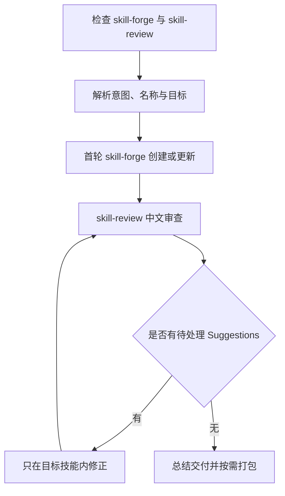

# skiller：创建技能并循环审查修正

将用户整段输入作为技能需求，先调用 `skill-forge` 创建或更新目标技能，再循环执行 `skill-review → 修正 Suggestions → 复审`，直到没有待处理建议。目标是完成指定技能，不从审查中的优点描述扩展新功能。

## 如何触发

入口设置了 `disable-model-invocation: true`，description 当前仅为 `ai-everything-skiller`，应显式调用。例如：

> 使用 skiller，创建 release-helper：从指定版本范围整理发布说明，只生成草稿。

> 使用 skiller，更新现有 my-helper，并循环审查修正到没有待处理建议。

自然语言例子说明使用方式，不代表当前简短 description 能稳定自动匹配这些请求。

## 内部流程

1. 确认两项依赖已安装且当前会话可调用。缺失时停止，仅输出缺失名称和安装提示，不先创建或审查。
2. 解析解决的问题、使用者、典型输入输出和技能名。没有名称时从意图推导小写连字符名称并告知；必要信息缺失才集中澄清。
3. 首轮调用 skill-forge，至少完成使用例子与触发词、资源架构、初始化或增量更新、描述、正文及交付检查。已有同名技能不重复初始化，落点沿用 skill-forge 和安装环境规则。
4. 记录目标技能名及根目录。仅审查该目录，由 skill-review 产出中文 Strengths 与按影响排序的 Suggestions。
5. 按 What/Where/Fix 修正目标目录内文件；每次修正必须回到审查，不把“已改”当作“已验证消失”。
6. Suggestions 为空或明确无进一步改进后交付。用户未禁止时，可选执行 skill-forge 的 package_skill.py 打包。

## 路由与限制

| 条件 | 后续行为 |
| --- | --- |
| 首轮，或用户明确要求从头重做 | 调用 skill-forge |
| 常规后续轮 | 只走 skill-review 与 Suggestions 修正，不重新生成整份技能 |
| Suggestions 有待处理项 | 只在记录的目标根目录内修正并复审 |
| 只有 Strengths 中出现额外想法 | 不实施，除非也被列为 Suggestions |
| 用户要求先确认 | 首轮生成阶段按请求停在对应确认点 |
| 依赖无法调用 | 不读仓库同名副本替代，不假装已完成依赖步骤 |

当前流程以“无待处理建议”为结束条件，没有单独定义无进展重试上限；不能把文档描述成带固定轮数的优化器，也不能将本流程宣称为独立代理审查。

## 产物与文件导航

交付目标技能目录、最终 Strengths 摘要和最后一轮 Suggestions 状态；可选保存 `.review/skill-<skill-name>-{timestamp}.md`，可选生成打包文件。审查只限目标，不扫描改写整个仓库。

- [SKILL.md](SKILL.md)：依赖检查、首轮生成、修正循环和完成条件。

本目录没有额外 references；创建与审查细则来自当前会话已安装的两项依赖。
