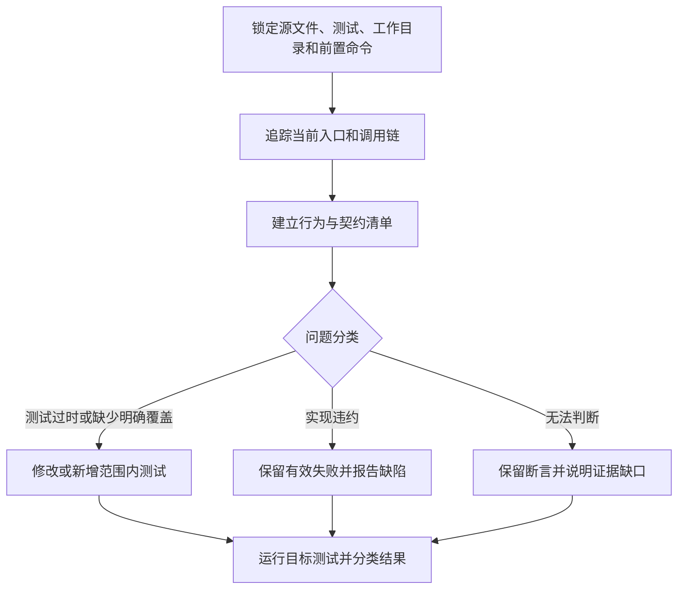

# test-helper：修正过时测试与补齐覆盖

先读取实际实现和调用链，再判断测试是否过期、实现是否违约，或需求仍不确定。只修有证据的过时测试，或补用户要求的覆盖，保留有效回归和用户改动，不能把错误实现直接复制成正确预期。

## 触发提示词

“重写测试”“测试用例”“补测试”“对齐测试”“实现为准”“检索实现”“重新实现测试”，以及 `test-helper`、`add tests`、`rewrite tests`、`update tests`、`fix tests`、`unit tests`。

> 为 src/auth 补充空输入和错误路径测试，沿用现有运行器。

> 检索当前实现，修正过时测试，保留实现缺陷对应的失败断言。

“实现为准”用于确认当前运行行为，不意味着实现天然正确。仅测试请求不授权修改生产代码。

## 内部流程

1. 指定目录时仅处理该目录下或对应模块的测试；未指定时从失败输出和相关改动推导最小范围，不能确定才问。显式全套请求才检查全部相关套件。
2. 从真实入口追踪服务、领域和边界，记录输入输出、副作用、并发及错误；区分同步 throw、Promise rejection 和捕获后返回值。不能只看旧测试、类型或注释推断运行行为。
3. 修改测试体前列出正常、错误、空值、边界和适用的幂等行为，并对应契约证据及已有案例。请求新增覆盖不需要先有失败；没有现成测试也可按项目约定新增。
4. 测试过时且没有未决契约冲突时更新；实现违反明确契约时保留失败；证据不足时不动争议断言。继续独立可修项。
5. 一例覆盖一个行为或错误路径，不复刻内部实现算期望，不把被测函数 mock 成正确答案。使用既有设施隔离时钟、网络、文件、随机和环境变量。
6. 选择真实测试文件及拥有它的包目录，保留配置、setup、预加载、构建和生成步骤。固定 glob 的脚本不能靠追加文件名假装收窄；使用一次性运行，避免 watch。
7. 核对测试确实被收集并完成，记录实际进程退出状态及通过、失败、跳过数量。共享状态清理还需核对失败路径，不能只凭单测独立通过证明隔离有效。

## 条件路由与失败处理

| 条件 | 行为 |
| --- | --- |
| 只要求修过时测试 | 不额外补无关覆盖 |
| 要求补测且行为已明确 | 复用已有有效用例，只补缺失项 |
| 明确契约与实现不符 | 保留失败并报告，生产修改另需授权 |
| 运行器、服务或环境缺失 | 报告阻塞，继续可独立运行的测试；不自动安装或连接真实服务 |
| 时间或网络不稳定 | 用项目现有模式诊断隔离，不跳过测试或削弱断言 |
| 退出码为 0 但零目标测试 | 排查选择器和目录，仍未收集则标为验证不完整 |
| 需要扩大路径或行为范围 | 只询问必要扩大项，继续独立范围内工作 |

本技能没有强制外部技能依赖，按阶段加载本目录 references。环境恢复区分变量不存在与空值，只清理测试自己创建的资源。

## 交付与文件导航

交付实际测试改动、行为覆盖映射、工作目录、前置步骤和命令、测试进程退出状态与数量，以及失败分类、环境限制和未验证项。不把零测试、其他命令成功或未执行套件写成全套通过。

- [SKILL.md](SKILL.md)：范围、分类和完整流程。
- [implementation-discovery.md](references/implementation-discovery.md)：实际实现与调用链检索。
- [contract-checklist.md](references/contract-checklist.md)：行为、证据和测试映射。
- [test-rewrite-patterns.md](references/test-rewrite-patterns.md)：最小覆盖、稳定性及资源隔离。
- [verification.md](references/verification.md)：命令选择、失败分类与完成判定。
